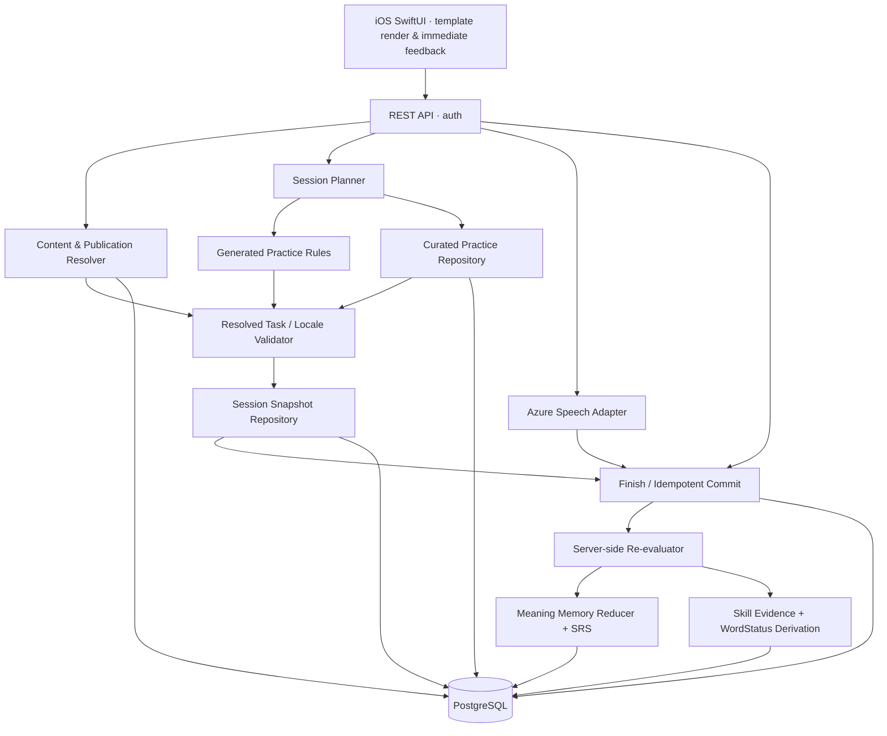
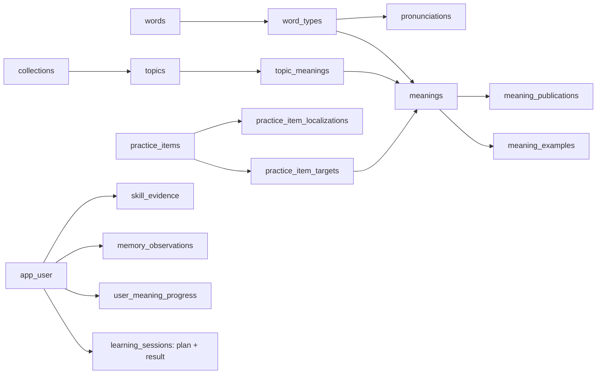

# VOCAB FLOW — Backend Technical Specification & PostgreSQL Schema

> **Version:** v0.4 · FULL SPEC · Engineering Review Draft  
> **Ngày:** 30/10/2026  
> **Phạm vi:** MVP · Backend, content, practice generation, localization, sessions, memory, skills, database & API  
> **Trạng thái:** **CHƯA APPROVE — đầy đủ để review độc lập, chưa dùng production**  
> **Tài liệu hiện tại:** Đặc tả kỹ thuật tự đủ (nêu đầy đủ yêu cầu, proposal và các điểm còn OPEN); không phải danh sách delta so với phiên bản trước.

## Giới thiệu và phạm vi tài liệu

Đây là **đặc tả backend độc lập, đầy đủ (FULL SPEC)** cho Vocab Flow MVP. Tài liệu quy định các yêu cầu sản phẩm đã được xác nhận, kiến trúc, mô hình dữ liệu, PostgreSQL DDL, contract API, bộ 7 practice templates, prompt text/audio dùng chung, mô hình luyện 4 kỹ năng, thuật toán memory/SRS, transaction/commit, Azure pronunciation và tiêu chí kiểm thử. Có thể đọc và triển khai thử từ đầu **mà không cần đối chiếu changelog**.

**Phạm vi chức năng:** Người học học từ vựng theo `Collection → Topic → Word → Type → Meaning`; mỗi Meaning là một đơn vị tiến trình. Mỗi Practice Task có đúng một prompt chính thuộc `text` **hoặc** `audio`, bất kể template nào. `select` dùng các variant lựa chọn nghĩa/âm/từ/trọng âm; `typing` có variant nghe-chép chính tả; `recording` ghi âm và chấm phát âm cho Speaking; `typing` và `flyReorder` ngẫu nhiên thay nhau ở slot Writing/active recall khi prompt là Meaning cue. Skill chỉ được cấp dựa trên **stimulus + hành động trả lời + target + delivery/hint quality**, không đơn thuần theo tên template hay `prompt.type`.

**7 templates độc lập:** `select`, `match`, `clozeSelect`, `typing`, `flyReorder`, `surgery`, `recording`. Mọi template **hỗ trợ** hai kiểu prompt ở cấp contract/resolver, nhưng mỗi task phát ra chỉ một mode đủ điều kiện về asset, locale, năng lực thiết bị và tính công bằng của câu hỏi.

**Ranh giới triển khai:** DDL ở §3 và file `.sql` đi kèm là **bootstrap cho database trống**, không phải migration áp dụng trực tiếp lên DB đang chạy. Tài liệu ở trạng thái Engineering Review Draft, chưa được tích hợp/kiểm thử trên PostgreSQL production. Các file Master Spec, Blueprint và iOS client code không có trong bộ upload nên không tuyên bố đã chỉnh sửa chúng.

---

## 0. Nguyên tắc và quyết định kiến trúc

**Quy ước:** `[AGREED]` yêu cầu đã xác nhận; `[BASELINE]` quy tắc MVP chấp nhận làm điểm bắt đầu nhưng phải đo/tuning; `[PROPOSED]` lựa chọn thiết kế của tài liệu này; `[TRIAL]` con số thử nghiệm; `[OPEN]` cần chủ sở hữu quyết định.

### 0.1. Yêu cầu sản phẩm và ràng buộc hệ thống

1. **[AGREED]** App ưu tiên vocabulary; tổ chức **Collection → Topic → Word → Type → Meaning**; Topic curate đến từng Meaning; progress duy nhất `(userId, meaningId)` dù xuất hiện nhiều Topics.
2. **[AGREED]** Một Daily Session: `Review Due → Learn New → Active Recall → Finish`; một new-Word goal slot = **một Meaning mới** của Word đó.
3. **[AGREED]** Daily, Checkpoint, Random, Weak đều **all-or-nothing**: abandon trước Finish không cập nhật learning; chỉ backend commit thành công mới có `learnedAt`, review progress, skill evidence.
4. **[AGREED product direction — v0.4]** 7 templates: `select`, `match`, `clozeSelect`, `typing`, `flyReorder`, `surgery`, `recording`; mọi template nhận prompt `text` hoặc `audio` qua envelope chung, subject to capability/content validation.
5. **[AGREED]** Practice Content = **Generated + Curated**. Hints theo template rule; generic explain được hệ thống cung cấp; contextual explain là curated optional. Core Meaning examples dùng ở Learn, **không tự động thành gameplay**.
6. **[AGREED]** Client **nhận task đã resolve đủ typed prompt text/audio/options/evaluation**, chấm bài ngay (trừ Azure Recording); không phải query Meaning để dựng câu hỏi; không trả `wordId`, `meaningId`, target metadata không cần thiết trong task response.
7. **[AGREED]** Public-facing business IDs dùng UUID (hoặc int nếu chọn lại đồng bộ); **không** dùng ID gắn với spelling `w_clarify`, `m_feedback`. Option/tile IDs chỉ là số nguyên cục bộ.
8. **[AGREED]** Speaking production qua Azure Pronunciation Assessment; một service lỗi/âm thanh vô hiệu **không phải một Speaking failure**.
9. **[BASELINE]** Skill status `notVerified → demonstrated → verified`; 2 direct success ở 2 committed sessions khác nhau và ít nhất một delayed recheck; valid direct failure sau đó rút verified.
10. **[AGREED]** Word verified chỉ xét **Meanings user đã learned**; Meaning SRS adaptive, recognition success tác động yếu, không gia hạn vô hạn.
11. **[AGREED]** Publish unit **Meaning × explanation locale**, yêu cầu approved linguistic + localized meaning/definition + ≥1 usable localized example + CEFR + IPA; audio không bắt buộc để publish.
12. **[AGREED — UPDATED v0.4]** Mỗi Meaning mới trong Daily Learning phải trải qua `select`, một trong `typing | flyReorder`, `recording`; các lượt thực hành được **interleave** với các Meaning khác. `recording` invalid/unavailable không phải failure hoặc lý do hủy học những Meaning còn lại.
13. **[AGREED — NEW]** Review/Practice có thể random giữa các template hợp lệ; **không** áp sequence New Learning cho Review. `meaningClash`/contextual usage phải phù hợp với năng lực ước lượng, tránh đánh đố người mới.
14. **[AGREED — NEW]** Trình độ lưu trực tiếp ở `app_user.proficiency_level` (không có `learning_level`); onboarding Quick Test hoặc Self-select, **không** lập bảng learner profile/placement history ở MVP.

### 0.2. Các lựa chọn kỹ thuật, chính sách và tham số

| Mã | Lựa chọn | Trạng thái |
|---|---|---|
| AR-01 | PostgreSQL 16+ làm database chính, JSONB cho Practice Content/snapshot/event | `[PROPOSED]` |
| AR-02 | Modular monolith, ví dụ NestJS/TypeScript + REST API | `[PROPOSED]` |
| AR-03 | 7 template definitions/evaluators trong code, **không bắt buộc** có `practice_templates` table | `[PROPOSED]` |
| AR-04 | **1** `practice_items` table cho các bài Curated (mọi template), localization table riêng, targets join table; Generated chỉ lưu snapshot khi lên session | `[PROPOSED]` |
| AR-05 | Backend resolves universal `prompt` envelope cho mọi template (`text | audio`), localizes text; client chỉ render; static chrome theo app resources | `[PROPOSED]` |
| AR-06 | Plan đã phát được giữ trong DB (metadata + snapshots) nhưng không lưu **user in-progress learning state** | `[PROPOSED]` |
| AR-07 | Client grades locally; backend replays submitted attempts against canonical session snapshot tại Finish | `[PROPOSED]` |
| AR-08 | Idempotency bằng `sessionId + SHA-256 canonical commit request`; user-level serialization khi commit | `[PROPOSED]` |
| AR-09 | UTC timestamp commit là nguồn `learnedAt`; Checkpoint Challenge mở sau mỗi 7 session có học từ mới, không theo thời gian | `[PROPOSED]` |
| AR-10 | SRS interval-based trial + Recognition Grace một lần | `[TRIAL]` |
| AR-11 | Default review cap 10/session, daily goal 5, delayed skill ≥24h; giới hạn tùy chỉnh | `[TRIAL]` |
| AR-12 | New learning: 4–5 lượt interleaved, mặc định 3 Select + 1 (Typing hoặc FlyReorder) + 1 Recording/Meaning | `[TRIAL]` |
| AR-13 | Introductory placement chỉ set 2 fields trong `app_user`, không có profile/placement tables | `[AGREED scope]` |
| AR-14 | `practice_items.context_cefr_level` + gating contextual theo `proficiency_level` | `[PROPOSED]` |
| AR-15 | `prompt.type` là modality của stimulus, **không** phải skill enum; same template may emit distinct valid skill evidence depending on target/answer/asset | `[PROPOSED]` |
| AR-16 | `typing | flyReorder` weighted random tại slot Meaning-cued recall, first-recall semantics/atomic commit giống nhau | `[PROPOSED]` |

| AR-17 | `select` variants `phoneticChoice`/`stressChoice` thay các audio-specific templates; `typing.transcription` thay audio transcription | `[AGREED product direction]` |
| AR-18 | `clozeSelect` = chọn một đáp án lấp chỗ trống (không phải arrange tiles); `recording` = capture + Azure scoring | `[AGREED product direction]` |

**Không đưa vào MVP:** microservices, Kafka, Redis bắt buộc, full CMS enterprise, 4 SRS engines, FSRS production, generic UI-from-JSON DSL.

---

## 1. Kiến trúc và module



| Module | Owns | Không làm |
|---|---|---|
| `identity` | User identity, 2 level fields trong `app_user`, preferences, locale, active scope | Update learning bằng client assertions, lưu Placement history riêng |
| `catalog` | Word/Type/Meaning, pronunciation, examples, publish | Gắn user progress vào core content |
| `practice-content` | Curated authoring, validations, template locale resources | Quyết định Word mastery |
| `practice-resolver` | Generate/resolve/validate task + client payload | Trả raw DB schema ra client |
| `session-planner` | Chọn Meanings; **New Meaning Interleaving Planner** với select/(typing | flyReorder)/recording bắt buộc; adaptive template selection cho Review; caps và issued snapshot | Lưu kết quả học trước Finish |
| `practice-evaluator` | Re-evaluate attempt sequence, per-target results | Tin `correct: true` client gửi |
| `memory-srs` | 1 memory observation/Meaning/session, due rules | Không update semantic memory từ bài phát âm hoặc chỉ phân biệt âm |
| `skill-verification` | Listening/Speaking/Reading/Writing evidence, derived statuses | 4 bộ SRS riêng |
| `session-commit` | Concurrency, idempotency, atomic write | Gọi Azure trong DB transaction |
| `speech` | Azure scoring và signed/DB-bound receipt | Tạo Speaking verified trước Finish |

### 1.1. Tech boundaries

- `[PROPOSED]` Chọn **PostgreSQL**; sử dụng cột chuẩn + FK/UNIQUE/transaction cho quan hệ và `JSONB` cho cấu trúc Practice theo template. Không phải JSONB cho mọi thứ.
- `[PROPOSED]` Audio lưu object storage/CDN với asset key/URL tạm; DB không lưu audio bytes.
- `[PROPOSED]` Background job tối thiểu (timer/cron) dọn issued plans/receipt hết hạn; không yêu cầu queue ngoài DB.
- `[PROPOSED]` Auth do service hiện có cung cấp; lấy `userId` từ verified access token, không nhận `userId` trong body của client.
- `[OPEN]` Backend framework, deployment provider, auth provider, object store/CDN, logging stack.

---

## 2. Domain & physical data model

### 2.1. Quan hệ chính



**ID strategy:** global records `UUID DEFAULT gen_random_uuid()`; int `optionId`/`tileId` chỉ có ý nghĩa bên trong task; no readable slug-as-ID. `slug` chỉ dùng trong admin/catalog nếu cần routing, không là PK.

### 2.2. Bảng và nguyên tắc lưu trữ

| Bảng/nhóm | Mục tiêu | Điểm mấu chốt |
|---|---|---|
| `app_user` | Identity + `proficiency_level` | A1–C2 nullable trước onboarding, **không có bảng placement riêng** |
| `words`, `word_types`, `meanings`, `pronunciations`, `meaning_examples` | Lexical source | FK, CEFR Meaning, IPA/type, examples thuộc Meaning |
| `meaning_localizations`, `example_localizations` | Editorial text theo locale | Không cho runtime đọc draft để thay bản published |
| `meaning_publications`, `active_meaning_publications` | Immutable approved snapshot per Meaning×locale | Editing mới không đổi bản đã phát |
| `collections`, `topics`, `topic_meanings` | Curated membership/rank đến Meaning | Không duplicate Word/Meaning |
| `collection_localizations`, `topic_localizations` | Title/description đa ngôn ngữ | UI catalog read theo locale |
| `practice_items` | **Chỉ Curated** core data và evaluation rules, mọi template chung 1 bảng | `source_content JSONB`, `source_evaluation JSONB`, optional `context_cefr_level` |
| `practice_item_localizations` | Clue/question/context explain ngôn ngữ giải thích | Không nhân bản source English context vô cớ |
| `practice_item_targets` | Item→Meaning/pronunciation targets | Matching có nhiều target |
| `learning_sessions` | **Một session là một dòng lịch sử practice**: issued plan, policy version, commit state, `plan`, `raw_events`, `result` | Issued ≠ in-progress learning record. `plan` bất biến, chỉ retention được xoá; `plan` và `raw_events` có thể purge, `result` giữ lâu dài |
| `learning_sessions.plan` | **Immutable per-session snapshot**: tasks, targets, Learn cards, answer key | Generated tasks cũng nằm ở đây sau khi resolve |
| `speech_assessment_receipts` | Azure technical staging để commit sau | Receipt không tạo learning evidence trước Finish |
| `learning_sessions.result` | Committed re-evaluated outcomes | Matching phải lưu per pair; giữ được sau khi `plan` bị purge |
| `memory_observations`, `user_meaning_progress` | SRS event + current state | PK `(user_id, meaning_id)` |
| `skill_evidence` | Direct/supporting/invalid evidence | Reading/Writing→Meaning; Listening/Speaking→Pronunciation; audio-meaning task có thể sinh semantic memory + Listening Evidence theo cặp target đã xác thực |
| `checkpoint_challenges`, `checkpoint_challenge_meanings` | Immutable challenge membership theo nhóm session | Không tạo empty challenge |

**Backend-only IDs** (`meaning_id`, `pronunciation_id`, `practice_item_targets`, `source_content`) tồn tại trong DB, **không tự động xuất hiện trong Practice response**.

### 2.3. Publication rules

- Edit Content có thể lưu draft ở các bảng core/localization; khi approve, backend validate và tạo `meaning_publications.snapshot` chứa Word/Type/Meaning/pronunciation/example đã approved **cho locale cụ thể**. Chỉ `active_meaning_publications` xác định bản đang live.
- Không update/delete snapshot published; promotion đổi pointer trong transaction; recall đặt `recalled_at`, resolver loại bỏ.
- Validator từ chối: CEFR thiếu/không hợp lệ, IPA trống, meaning/definition locale trống, thiếu example source/target/translation hoặc highlight lỗi; audio optional.
- `meaning_publications.snapshot` là aggregate riêng của runtime; ID Meaning giữ nguyên qua publication revisions.
- Cần enforce immutable ở **service permissions & migration policy**, không chỉ tin conventions. Có thể thêm `BEFORE UPDATE/DELETE` trigger sau khi review nếu cần chống chỉnh thủ công.
- Với Curated Practice, mỗi `practice_items.id` là một **content revision**. Muốn sửa bản published, tạo row mới với `supersedes_item_id`, approve locale mới; session cũ vẫn giữ snapshot. Đây là bản MVP đơn giản thay vì xây full revision CMS.
- `[OPEN]` Minimal editor workflow/ACL (author/editor/publisher), cách phục hồi sau accidental recall, promotion approval audit fields.

### 2.4. Practice generation vs curation

**Không tạo N×7 rows khi import vocabulary.** Resolver làm việc theo `template`, `variant`, target, locale, capabilities và `prompt.type`. **Template xác định cách người học tương tác/trả lời; `prompt.type` chỉ xác định nguồn kích thích text/audio.** Mỗi task đã issue phải có đúng một prompt chính, đủ điều kiện nội dung và asset. Không mặc nhiên audio prompt đồng nghĩa với direct Listening hay semantic memory.

| Template | Tương tác cốt lõi | Các variant minh họa | Prompt `text` / `audio` |
|---|---|---|---|
| `select` | Chọn **một** đáp án trong `options` theo `correctOptionId` | `gloss`, `reverseGloss`, `meaningClash`, `phoneticChoice` (trước là audioSelect), `stressChoice` (trước là sound split) | Chữ/câu hoặc phát audio; `options` có thể chứa từ, nghĩa hay lựa chọn trọng âm |
| `match` | Ghép các cặp từ ↔ nghĩa, theo pair IDs | `meaningPairs`, `wordPairs` | Text/audio hướng dẫn; media của từng pair là phần riêng của body |
| `clozeSelect` | **Chọn từ** trong các options để lấp một ô trống của câu, không xếp lại toàn câu | `singleBlank`, optional `contextMeaning` | Text/audio clue tuỳ chọn, bỏ `prompt` khi không có clue thật; câu chỉ nằm ở `sentenceParts`, body có `sentenceParts` và `options` |
| `typing` | Nhập câu trả lời tự do bằng keyboard | `meaningRecall` hoặc `transcription` (trước là audio trace) | Text Meaning cue, audio Meaning cue hoặc tiếng Anh được phát để chép |
| `flyReorder` | Chọn/sắp thứ tự các grapheme tiles bay vào ô đáp án | `spellingRecall` | Text/audio cue; trả ordered `tileIds`, không gửi chuỗi đáp án như nguồn tin |
| `surgery` | Chọn/sửa grapheme lỗi | `fixSpelling` | Text/audio cue, lỗi chính tả nằm trong `word` body |
| `recording` | Ghi âm giọng người học và lấy kết quả **Azure Pronunciation Assessment** | `scriptedPronunciation` | Text word cue hoặc audio mẫu; ghi âm là response, không phải audio prompt |

**Quy tắc hợp nhất các bài cũ:** `audioSelect` → `select` + `variant=phoneticChoice`; `split`/sound split → `select` + `variant=stressChoice`; `trace`/audio trace → `typing` + `variant=transcription`. `select(audio, gloss)` dùng tiếng Anh phát âm để chọn **nghĩa**; `select(audio, phoneticChoice)` dùng tiếng Anh phát âm để chọn **từ được nghe**; `select(audio, stressChoice)` dùng tiếng Anh phát âm để chọn **vị trí trọng âm**. Ba mục tiêu khác nhau, **một evaluator chọn đáp án** và cùng schema prompt. `typing(audio, transcription)` là gõ lại từ nghe được, không tự tạo semantic recall.

**`clozeSelect` là hành vi chọn từ vào ô trống, không phải kéo/xếp nhiều từ thành câu.** Với `prompt.type=text`, stimulus là câu có blank hoặc clue, không chỉ câu hướng dẫn chung. Với audio, nội dung phát phải giữ blank không bị đọc lộ đáp án; phần câu/từ xuất hiện trên màn hình phải được QA để không tiết lộ target. Nếu muốn bài xếp cả câu trong tương lai, đó là interaction khác và cần thiết kế riêng; không dùng lại tên `clozeSelect` một cách sai ngữ nghĩa. Câu contextual chỉ được dùng khi được duyệt CEFR và đáp án không mơ hồ.

**Invariants:** `prompt.type` không cố định theo template; `variant` mô tả mục tiêu/đánh giá của task, khác `prompt.type`. Body (`options`, `sentenceParts`, `tiles`, `pairs`, `word`, `assessment`) được validate riêng theo template+variant. Trong audio question blind, không lộ transcript/target trước attempt. Tất cả 7 templates nhận universal prompt object, nhưng mỗi phối hợp thực tế phải hợp lệ và khả thi.

**Authoring representation `[PROPOSED]`:** `practice_items.source_content` cho curated tasks có thể lưu `promptVariants.text` và/hoặc `promptVariants.audio` (symbolic approved asset references + locale + cue descriptor), **không** lưu client-ready expiring URLs; Generated templates nhận options từ resolver. Tại issuance chỉ chọn **một** mode, tạo fully resolved `client_payload.prompt` như §2.5; không bắt Curated item nào cũng phải có cả hai modes nếu không có media/QA, nhưng **mọi template** phải có code path xử lý cả text và audio. Nếu thiếu variant, reject candidate hoặc planner chọn alternative hợp lệ — không tự đổi audio stimulus thành text khi cần Listening direct.

**Dual-target mapping:** `practice_item_targets`/targets trong `learning_sessions.plan` cho phép `(meaning_id, pronunciation_id)` cùng hiện diện nếu thật sự là một Word/Type hợp lệ; ít nhất một non-null. Ví dụ `select(audio)` cần Meaning target để cập nhật semantic memory, Pronunciation target để cấp Listening evidence. Recording chỉ cần pronunciation. Backend chống linking hai IDs thuộc các Word/Type khác nhau.

### 2.5. Localization pipeline: câu hỏi Generated dịch thế nào?

Có ba nguồn text/audio được resolve trước khi phát task:

1. **Template copy** (`practice/locale/vi-VN.json`, `en-US.json`) trong versioned backend resources: static instructions và localized dynamic question (`select.gloss.question`, `typing.clue.question`, `flyReorder.clue.question`, `match.title`, ...).
2. **Published Vocabulary locale** từ `meaning_publications.snapshot`: Meaning, definition, example translations và pronunciation asset/IPA nếu available.
3. **Curated item locale** từ `practice_item_localizations`: authored localized clue/context explanation/options, các audio references nếu được curate; learning-language text giữ nguyên khi chính là đối tượng kiểm tra.

`resolve(template, target, explanationLocale, promptType, capabilities, contentVersion)` → lấy published content → chọn variant prompt được phép → localize cue/answer → lấy/playback asset nếu audio → validate assets/QA/target scope/answer non-leakage → tạo `task` đã resolve → lưu immutable snapshot → trả payload tự đủ. Không runtime machine-translate hoặc im lặng thay explanation locale.

**Quy tắc `prompt` universal — áp dụng cho mọi template:**

```ts
type Prompt =
  | { type: 'text'; text: string }
  | { type: 'audio'; audio: { url: string; locale: string } };

// Task = { id, template, variant?, prompt: Prompt, question?, ...templateBody, evaluation? }
```

- Một task **chỉ có một primary prompt mode** (`text` hoặc `audio`), không được nhét đồng thời `text` và `audio` làm primary cue. `question`/`instruction` vẫn có thể là text hướng dẫn chung, **không phải bản chép lời** của audio stimulus.
- `audio.url` là resolved playable URL HTTPS hoặc URI client-supported; URI/path/file name phải opaque, không lộ transcript/spelling/answer key cho bài nghe mù. `locale` bắt buộc, mô tả ngôn ngữ/giọng của audio; validate expected pronunciation/locale. Backend giữ authoritative transcript/asset key ở snapshot nội bộ nếu cần.
- Với audio nghe hiểu, không đưa từ/câu đang được kiểm tra vào `question`, lựa chọn trả lời, hints hoặc trường body khác làm lộ đáp án trước attempt. Với `recording`, có thể hiển thị text mục tiêu nếu thiết kế chủ đích là luyện đọc phát âm; scoring luôn căn cứ server target.
- Prompt `audio` chỉ được plan khi client có `audioPlayback` và playable asset tương ứng. Không có asset: chọn text variant hợp lệ hoặc replan; **không** tạo fake URL. Nếu task audio đã issued mà playback thực tế thất bại, dùng event `deliveryMode=fallback` (nếu template cho phép) hoặc `unavailable`, không claim Listening direct.
- `prompt.type` quyết định render, **không** quyết định skill một mình; backend xác định từ `assessmentIntent` nội bộ + canonical target + reply type + delivered mode + hints/reveals.

Phân biệt `learningLanguage` (`en`), `pronunciationAccent` (`en-US`), `explanationLocale` (`vi-VN`), `uiLocale`; audio nghe từ tiếng Anh phải là ngôn ngữ đang học. Audio của một lời hướng dẫn tiếng Việt không tự trở thành Listening skill tiếng Anh.

```json
{
  "select.gloss.question": "Từ này có nghĩa là gì?",
  "typing.clue.question": "Viết từ tiếng Anh tương ứng với nghĩa sau:",
  "flyReorder.clue.question": "Ghép các chữ cái để tạo thành từ tiếng Anh:",
  "match.title": "Ghép các cặp tương ứng."
}
```

**Select text prompt — Reading:**

```json
{
  "id": "b48f61a0-4d53-4e66-b231-233b7cb6de31",
  "template": "select", "variant": "gloss",
  "prompt": {"type": "text", "text": "clarify"},
  "question": "Từ này có nghĩa là gì?",
  "options": [{"id": 1, "text": "làm rõ"}, {"id": 2, "text": "hạn chót"}],
  "evaluation": {"correctOptionId": 1}
}
```

**Select audio prompt — Listening (same template/evaluator, no orthography leak):**

```json
{
  "id": "c48f61a0-4d53-4e66-b231-233b7cb6de32",
  "template": "select", "variant": "gloss",
  "prompt": {"type": "audio", "audio": {
    "url": "https://cdn.example.invalid/audio/asset-8c42a1.mp3", "locale": "en-US"
  }},
  "question": "Nghe và chọn nghĩa đúng.",
  "options": [{"id": 1, "text": "làm rõ"}, {"id": 2, "text": "hạn chót"}],
  "evaluation": {"correctOptionId": 1}
}
```

`cdn.example.invalid` chỉ là fixture placeholder, không bao giờ được phát làm asset thật. Client không query thêm Meaning để dựng bài; `task.id` mapping target/server_evaluation ở backend-only. `prompt` schema **giống hệt** trên `select`, `match`, `clozeSelect`, `typing`, `flyReorder`, `surgery`, `recording`.

### 2.6. Client contract — tiêu chí "minimal but complete"

**Allowed on all Practice Tasks:** `id` UUID, `template`, optional `variant`, **required `prompt: Prompt`**, optional `question`/`clue`/`tiles`/`options`/`pairs`/`word`/`syllables`/`feedback explanation`, and task-specific `evaluation` where local grading supported. `audio` inside `prompt` is media stimulus; additional nested audio in pair/body may exist when template explicitly needs it.

**Not on Practice Task:** `wordId`, `meaningId`, `pronunciationId`, `typeId`, `source`, `targets`, raw authoring entity, target-language transcript for blind audio question, internal scoring weights, detailed SRS/skill status, DB policies. Word Overview screen/API may expose Word ID separately.

- Client shared `PromptRenderer` switches on `prompt.type`. Every template gets the same text/audio prompt interface; template body/interaction renderer stays independent.
- Client local checking for `select/match/clozeSelect/typing/flyReorder/surgery`; `recording` uses backend Azure and assessed receipt. Prompt mode does not change answer evaluator key.
- `flyReorder.tiles = [{"id": 1, "text": "c"}, ...]` are **Unicode grapheme clusters**, stable integer IDs per task and can include duplicate letters with distinct IDs. Client supports tap tile, untap/remove, move selected tile to a new index, undo, submit; animation is UI-only. Never use the rendered response string as trusted submit truth.
- At Finish client sends only task UUID + versioned interaction events, first attempt/retry/hint/reveal, actual audio/fallback delivery and receipt. Backend replays against immutable snapshot, not client `correct=true`/`skill=...` assertions.
- For `flyReorder`, submitted `tileIds` must match ordered picked IDs; server constructs grapheme string from issued snapshot and verifies policy. Same first Meaning-cued recall role as typing; no separate learnedAt pathway.

**FlyReorder text/audio examples (same evaluator):**

```json
{
  "template": "flyReorder",
  "prompt": {"type": "text", "text": "làm rõ"},
  "tiles": [{"id":1,"text":"r"},{"id":2,"text":"c"},{"id":3,"text":"l"},{"id":4,"text":"a"},{"id":5,"text":"i"},{"id":6,"text":"f"},{"id":7,"text":"y"}],
  "evaluation": {"acceptedResponses": ["clarify"]}
}
```

```json
{
  "template": "flyReorder",
  "prompt": {"type": "audio", "audio": {"url":"https://cdn.example.invalid/audio/meaning_vi.mp3","locale":"vi-VN"}},
  "tiles": [{"id":1,"text":"r"},{"id":2,"text":"c"},{"id":3,"text":"l"},{"id":4,"text":"a"},{"id":5,"text":"i"},{"id":6,"text":"f"},{"id":7,"text":"y"}],
  "evaluation": {"acceptedResponses": ["clarify"]}
}
```

Ví dụ audio `flyReorder` đọc **nghĩa tiếng Việt**, nên nó vẫn là Meaning-cued Writing, không phải Listening tiếng Anh. Nếu đọc **chính từ tiếng Anh** thì `flyReorder` là chính tả/transcription và **không** được mặc định tính semantic active recall. Sample body không có UUID chỉ để minh họa các fields trọng tâm; API thực luôn có `id` UUID.

#### 2.6.1. Resolved task fixtures — template và variant độc lập với prompt

Các fixture dưới đây minh họa JSON shape, không phải nội dung production. `cdn.example.invalid` là placeholder; task thật phải có UUID, media thật, QA, scope và canonical evaluation snapshot. Các fixture cho variants đã gộp **không tạo thêm template**.

**`match` — ghép các cặp (audio chỉ là prompt chính):**

```json
{
  "id":"10000000-0000-4000-8000-000000000001", "template":"match", "variant":"meaningPairs",
  "prompt":{"type":"audio","audio":{"url":"https://cdn.example.invalid/audio/asset-1f2a.mp3","locale":"vi-VN"}},
  "pairs":{"left":[{"id":1,"text":"clarify"},{"id":2,"text":"achieve"}],
           "right":[{"id":3,"text":"đạt được"},{"id":4,"text":"làm rõ"}]},
  "evaluation":{"correctPairs":[{"leftId":1,"rightId":4},{"leftId":2,"rightId":3}]}
}
```

**`clozeSelect` — chọn một từ để điền ô trống (không reorder cả câu):**

```json
{
  "id":"10000000-0000-4000-8000-000000000002", "template":"clozeSelect", "variant":"singleBlank",
  "sentenceParts":{"before":"Could you ","after":" the requirements?"},
  "options":[{"id":1,"text":"clarify"},{"id":2,"text":"arrive"},{"id":3,"text":"forget"}],
  "evaluation":{"correctOptionId":1}
}
```

**`select.phoneticChoice` — người học chọn chữ tương ứng với audio (thay audioSelect):**

```json
{
  "id":"10000000-0000-4000-8000-000000000003", "template":"select", "variant":"phoneticChoice",
  "prompt":{"type":"audio","audio":{"url":"https://cdn.example.invalid/audio/asset-8c42a1.mp3","locale":"en-US"}},
  "question":"Chọn từ bạn vừa nghe.",
  "options":[{"id":1,"text":"clarify"},{"id":2,"text":"classify"}],
  "evaluation":{"correctOptionId":1}
}
```

**`typing.meaningRecall` — audio tiếng Việt đọc nghĩa, người học gõ từ:**

```json
{
  "id":"10000000-0000-4000-8000-000000000004", "template":"typing", "variant":"meaningRecall",
  "prompt":{"type":"audio","audio":{"url":"https://cdn.example.invalid/audio/asset-vi-6c3b.mp3","locale":"vi-VN"}},
  "evaluation":{"acceptedResponses":["clarify"]}
}
```

**`surgery` — text cue, tìm và thay grapheme sai:**

```json
{
  "id":"10000000-0000-4000-8000-000000000005", "template":"surgery", "variant":"fixSpelling",
  "prompt":{"type":"text","text":"Tìm và xóa một chữ cái thừa."},
  "word":"clarrify", "evaluation":{"wrongGraphemeIndex":4,"replacement":""}
}
```

**`select.stressChoice` — chọn vị trí trọng âm (thay sound split):**

```json
{
  "id":"10000000-0000-4000-8000-000000000006", "template":"select", "variant":"stressChoice",
  "prompt":{"type":"audio","audio":{"url":"https://cdn.example.invalid/audio/asset-8c42a1.mp3","locale":"en-US"}},
  "question":"Âm tiết nào được nhấn trọng âm?",
  "options":[{"id":1,"text":"clar"},{"id":2,"text":"i"},{"id":3,"text":"fy"}],
  "evaluation":{"correctOptionId":1}
}
```

**`typing.transcription` — nghe và gõ từ (thay audio trace):**

```json
{
  "id":"10000000-0000-4000-8000-000000000007", "template":"typing", "variant":"transcription",
  "prompt":{"type":"audio","audio":{"url":"https://cdn.example.invalid/audio/asset-8c42a1.mp3","locale":"en-US"}},
  "evaluation":{"acceptedResponses":["clarify"]}
}
```

**`recording` — text cue, ghi âm rồi lấy Azure pronunciation receipt:**

```json
{
  "id":"10000000-0000-4000-8000-000000000008", "template":"recording", "variant":"scriptedPronunciation",
  "prompt":{"type":"text","text":"clarify"},
  "assessment":{"kind":"azurePronunciation"}
}
```

**Quy tắc client:** `select` dùng đúng một evaluator `correctOptionId` cho `gloss`, `phoneticChoice`, `stressChoice`. Các option IDs phải phản ánh lựa chọn mà user bấm, không dựa vào chỉ số UI; `stressChoice` có thể hiển thị options là các âm tiết. `typing` dùng cùng accepted-response evaluator cho Meaning-cued recall và transcription; **assessment intent** và memory/skill semantics vẫn khác nhau. `recording` gọi backend assessment, không có local pass key. `clozeSelect` đánh giá correct option cho đúng blank. `surgery.wrongGraphemeIndex` là zero-based Unicode grapheme offset.

### 2.7. Proficiency & Learning Level — chỉ hai cột trên `app_user`

**[AGREED]** Giữ tối giản, không có `user_learning_profiles`, `placement_sessions`, proficiency history hoặc auto-adjust algorithm trong MVP.

- `proficiency_level`: khả năng ước lượng của user tại onboarding; nhận từ quiz ngắn hoặc user tự đánh giá. NULL khi chưa onboarding. **Đây không phải chứng chỉ CEFR.**
- `proficiency_level` cũng dùng để **sắp xếp** Meaning CEFR khi chọn new items (không lọc cứng): từ có CEFR ≥ level trước, gần level nhất trước, sau đó mới đến từ dễ hơn, nên pool không bao giờ rỗng chỉ vì thiếu từ đúng level; scope Collection/Topics vẫn có hiệu lực, và không thay `user_meaning_progress`.
- `proficiency_level` giúp chọn độ khó **câu contextual** trong Review và Practice. Nếu NULL, default dùng bài direct meaning, không ép contextual assessment.
- Quick Test và Self-select chỉ tạo **giá trị cuối** trên user; không lưu từng câu thử hoặc nâng/giảm level tự động theo SRS trong MVP.
- Trình độ do user tự chọn cũng có thể bị ước lượng sai; client nên cho đổi dễ dàng, nhưng backend không coi nó là khả năng được xác minh.

**Onboarding** `[PROPOSED API]`:

`PUT /v1/me/levels`

```json
{
  "proficiencyLevel": "A2"
}
```

Backend kiểm tra A1/A2/B1/B2/C1/C2 và set trực tiếp field này. UI có thể chấm Quick Test trên client (bộ câu đã kiểm duyệt) hoặc người dùng chọn level; kết quả không tạo `learnedAt`, review history, Skill Evidence. Không lưu `placementSource` để tránh thêm metadata chưa cần.

**DB invariant:** chỉ có `proficiency_level`. Selection ưu tiên theo CEFR nhưng không chọn Meaning chưa published/không đúng scope; thiếu từ đúng level thì lấy từ gần level nhất thay vì trả plan rỗng.

### 2.8. Daily New Learning — Learning Cycle & interleaving

**[AGREED product direction v0.4] Mỗi focused Meaning mới phải có:**

1. Một Learn Card với Word/Type/Meaning, IPA, ví dụ, audio khi available (Learn Card không phải Practice Task).
2. ≥1 `select` nhằm nhận diện Word↔Meaning; `prompt.type` chọn `text` hoặc `audio` dựa trên valid asset, device capabilities và coverage. Gợi ý phân bổ cả text/audio qua New+Review, **không** bắt mọi Meaning đủ bốn skills ngay New.
3. ≥1 Meaning-cued **`typing` HOẶC `flyReorder`** làm first active recall. Planner random/weighted-random ở chính slot này (trial 50/50 khi cả hai eligible). Attempt đúng/sai vẫn tính completed first-recall để đủ điều kiện learnedAt sau Finish.
4. ≥1 `recording` ghi âm/chấm Azure, `prompt` có thể là text word cue hoặc audio model cue; microphone/tech unavailable không phải Speaking failure.
5. Mọi prompt đều theo universal text/audio envelope; interleave các Meaning khác nhau, tránh đáp án xuất hiện ngay trước Meaning-cued recall.

**[TRIAL]** 5 opportunities/Meaning: `select(gloss)` → `select(reverseGloss)` → `typing | flyReorder` → `recording` → `select(gloss)`; mọi slot `select` có thể dùng text/audio hợp lệ, và audio-only không thay thế bằng URL không chạy. Con số 4–5, độ dài, phân phối mode, weighted random đều cần UX measurements.

**Interleaving ví dụ 3 Meaning A/B/C:**

```text
Learn A → Select A(text)
Learn B → Select B(audio)
Learn C → Select C(text)
Select B(reverse) → Select A(reverse) → Select C(reverse)
FlyReorder A → Typing C → FlyReorder B
Recording B(audio prompt) → Recording A(text prompt) → Recording C(audio prompt)
Select C(audio) → Select A(text) → Select B(audio)
Finish → 1 atomic commit
```

`plan.learnSteps[].firstRecallTaskId` trỏ tới task được planner chọn (`typing` **hoặc** `flyReorder`), và service phải validate cùng Meaning, `phase=newPractice` và first meaningful recall attempt; **không** hardcode typing. `select` cần submitted attempt; `typing | flyReorder` cần submit first attempt; `recording` cần terminal `assessed` hoặc `unavailable`. Lỗi kỹ thuật Recording không hủy khả năng Finish; một attempt recording sai hợp lệ vẫn không ngăn learnedAt. Actual memory/skill chỉ commit tại Finish. Không tính 5 SRS successes từ 5 opportunities trong cùng session.

**Meaning-cued recall eligibility:** prompt phải cung cấp nghĩa/hint hợp lệ, không chứa sẵn spelling target. `typing/flyReorder` audio prompt đọc nghĩa là hợp lệ; audio đọc chính spelling Word là transcription, **không** thỏa điều kiện new Meaning first semantic recall. FlyReorder có tiles từ đáp án nên evidence Writing có thể yếu hơn typing; ở MVP vẫn dùng cho Meaning recall nhưng local hint/reveal/priming cần được ghi lại. Hãy giữ nhóm `typing | flyReorder` trước `recording` để hạn chế priming.

**[PROPOSED MVP]** Static pre-planned 4–5 steps, không tự sinh thêm task giữa session; reject planner candidate không đủ 3 mandatory groups. All-or-nothing giữ nguyên; đo abandonment khi task count tăng.

### 2.9. Review/Practice Selection & Contextual Gating

- **[AGREED]** Daily Due, Checkpoint, Random, Weak dùng weighted random giữa **7 template** phù hợp capability/content. Planner quyết định **template + prompt modality + assessment intent** trước khi issue, không ép thứ tự New.
- **[PROPOSED]** Daily Due chỉ consume/đổi Meaning SRS nếu có eligible semantic task: `select` text/audio với nghĩa → lựa chọn Meaning, Meaning-cued `typing | flyReorder`, hoặc curated contextual semantic assessment. `select(audio)` có **cả** recognition MemoryObservation trên Meaning và direct Listening candidate trên Pronunciation nếu real audio/first try/no hint; Recording/Split/Sound-only không consume meaning due.
- `select.phoneticChoice` giữ khả năng phân biệt từ có âm gần nhau, nhưng không coi thành công đó là semantic recognition; nghe từ rồi chọn nghĩa dùng `select.gloss` với audio prompt.
- Curated contextual `context_cefr_level <= app_user.proficiency_level` mới eligible independent contextual tests; NULL => only direct/simple teaching. `proficiency_level` cũng chỉ sắp xếp Meaning mới, không phải proof of language skill.
- Reading có thể được xác minh ở **phạm vi nhận diện từ-đến-nghĩa**, không bắt buộc contextual meaningClash. Curated contextual vẫn là value-add cho nâng cao, không phải gate bắt buộc để hoàn tất MVP word verification.
- `prompt.type` **không phải** skill mapping: `typing(audio)` với audio đọc nghĩa tiếng Việt → Writing; `select(audio)` đọc tiếng Anh và chọn nghĩa → Listening; `recording(audio)` luyện nói → Speaking; `match(audio)` dạng instructions audio mà từ target không được nghe → không cấp Listening direct.
- Nếu prompt audio không khả dụng trước plan, chọn eligible text variant **của cùng template** hoặc template khác; task-specific audio gates (`typing.transcription`, audio-only auditory recognition) có thể khiến candidate không eligible. Không fallback transcript khi đã chấm direct Listening. Không chọn task chỉ vì template có tên `audio`.

**Random không có nghĩa là uniform.** Check locale, assets, targets, CEFR, response type & no-answer-leak trước; sau đó mới random giữa eligible candidates.

## 3. PostgreSQL Schema — full proposed DDL

**Quy ước giá trị enum:** trong DB, JSONB và API, giá trị enum viết lower_snake_case (`random_practice`, `fly_reorder`). Tên camelCase trong phần mô tả của tài liệu này là tên logic của cùng giá trị.

**Phạm vi DDL:** schema v0.4 tham chiếu cho DB trống; chưa migrate trên DB production; tên/index/ACL còn được review. Dùng PostgreSQL 16+ (policy lựa chọn, không phải phụ thuộc tính năng độc quyền PG16). File `001_initial_schema_v0.4_FULL_SPEC_PROPOSED.sql` đi kèm là cùng nội dung để team lấy làm khởi tạo DB trống; chưa có migration delta cho DB đã triển khai v0.1/v0.2.

```sql
-- Vocab Flow MVP · Backend Spec v0.4 · PostgreSQL 16+ reference bootstrap · REVIEW DRAFT
-- Prerequisite: app-controlled migrations; DB role with UUID generator support.
-- UUID generation uses PostgreSQL built-in gen_random_uuid().
-- Operational precondition: existing auth system sends verified identity subject.
BEGIN;

-- A. Identity, preferences and curated scope
CREATE TABLE app_user (
    id UUID PRIMARY KEY DEFAULT gen_random_uuid(),
    identity_subject TEXT NOT NULL UNIQUE,
    proficiency_level VARCHAR(2) CHECK (proficiency_level IN ('A1','A2','B1','B2','C1','C2')),
    created_at TIMESTAMPTZ NOT NULL DEFAULT now()
);

CREATE TABLE user_settings (
    user_id UUID PRIMARY KEY REFERENCES app_user(id) ON DELETE CASCADE,
    learning_language VARCHAR(16) NOT NULL DEFAULT 'en',
    explanation_locale VARCHAR(32) NOT NULL DEFAULT 'vi-VN',
    ui_locale VARCHAR(32) NOT NULL DEFAULT 'vi-VN',
    time_zone VARCHAR(64) NOT NULL DEFAULT 'Asia/Ho_Chi_Minh',
    daily_new_word_goal SMALLINT NOT NULL DEFAULT 5 CHECK (daily_new_word_goal BETWEEN 1 AND 30),
    updated_at TIMESTAMPTZ NOT NULL DEFAULT now()
);

CREATE TABLE collections (
    id UUID PRIMARY KEY DEFAULT gen_random_uuid(),
    slug TEXT NOT NULL UNIQUE,
    title TEXT NOT NULL,
    status VARCHAR(16) NOT NULL DEFAULT 'draft'
       CHECK (status IN ('draft','published','archived'))
);
CREATE TABLE topics (
    id UUID PRIMARY KEY DEFAULT gen_random_uuid(),
    collection_id UUID NOT NULL REFERENCES collections(id),
    slug TEXT NOT NULL,
    title TEXT NOT NULL,
    status VARCHAR(16) NOT NULL DEFAULT 'draft'
       CHECK (status IN ('draft','published','archived')),
    UNIQUE (collection_id, slug)
);
CREATE TABLE collection_localizations (
    collection_id UUID NOT NULL REFERENCES collections(id),
    locale VARCHAR(32) NOT NULL,
    title TEXT NOT NULL,
    description TEXT,
    PRIMARY KEY (collection_id, locale)
);
CREATE TABLE topic_localizations (
    topic_id UUID NOT NULL REFERENCES topics(id),
    locale VARCHAR(32) NOT NULL,
    title TEXT NOT NULL,
    description TEXT,
    PRIMARY KEY (topic_id, locale)
);
CREATE TABLE user_learning_scope (
    user_id UUID PRIMARY KEY REFERENCES app_user(id) ON DELETE CASCADE,
    collection_id UUID NOT NULL REFERENCES collections(id),
    updated_at TIMESTAMPTZ NOT NULL DEFAULT now()
);
CREATE TABLE user_active_topics (
    user_id UUID NOT NULL REFERENCES app_user(id) ON DELETE CASCADE,
    topic_id UUID NOT NULL REFERENCES topics(id),
    PRIMARY KEY (user_id, topic_id)
);

-- B. Canonical vocabulary data (editor may edit drafts; runtime reads published snapshots)
CREATE TABLE words (
    id UUID PRIMARY KEY DEFAULT gen_random_uuid(),
    language VARCHAR(16) NOT NULL,
    lemma TEXT NOT NULL,
    homograph_key TEXT,
    created_at TIMESTAMPTZ NOT NULL DEFAULT now()
);
CREATE TABLE word_types (
    id UUID PRIMARY KEY DEFAULT gen_random_uuid(),
    word_id UUID NOT NULL REFERENCES words(id),
    part_of_speech VARCHAR(32) NOT NULL CHECK (part_of_speech IN
       ('noun','verb','adjective','adverb','pronoun','preposition','conjunction','interjection','phrasal_verb')),
    UNIQUE (id, word_id)
);
CREATE TABLE pronunciations (
    id UUID PRIMARY KEY DEFAULT gen_random_uuid(),
    type_id UUID NOT NULL REFERENCES word_types(id),
    accent_locale VARCHAR(32) NOT NULL,
    ipa TEXT, -- may be NULL in draft; publish validator requires IPA
    audio_asset_key TEXT,
    created_at TIMESTAMPTZ NOT NULL DEFAULT now(),
    UNIQUE (type_id, accent_locale),
    CHECK (ipa IS NULL OR length(btrim(ipa)) > 0)
);
CREATE TABLE meanings (
    id UUID PRIMARY KEY DEFAULT gen_random_uuid(),
    type_id UUID NOT NULL REFERENCES word_types(id),
    cefr_level VARCHAR(2) CHECK (cefr_level IN ('A1','A2','B1','B2','C1','C2')),
    core_definition TEXT, -- nullable in draft; publish requires a usable definition
    created_at TIMESTAMPTZ NOT NULL DEFAULT now()
);
CREATE TABLE meaning_examples (
    id UUID PRIMARY KEY DEFAULT gen_random_uuid(),
    meaning_id UUID NOT NULL REFERENCES meanings(id),
    source_text TEXT NOT NULL,
    target_locator JSONB NOT NULL,
    CHECK (jsonb_typeof(target_locator) = 'object')
);
CREATE TABLE meaning_localizations (
    meaning_id UUID NOT NULL REFERENCES meanings(id),
    locale VARCHAR(32) NOT NULL,
    meaning_text TEXT NOT NULL,
    definition_text TEXT NOT NULL,
    editorial_state VARCHAR(16) NOT NULL DEFAULT 'draft'
       CHECK (editorial_state IN ('draft','approved')),
    updated_at TIMESTAMPTZ NOT NULL DEFAULT now(),
    PRIMARY KEY (meaning_id, locale)
);
CREATE TABLE example_localizations (
    example_id UUID NOT NULL REFERENCES meaning_examples(id),
    locale VARCHAR(32) NOT NULL,
    translation_text TEXT NOT NULL,
    PRIMARY KEY (example_id, locale)
);
CREATE TABLE topic_meanings (
    topic_id UUID NOT NULL REFERENCES topics(id),
    meaning_id UUID NOT NULL REFERENCES meanings(id),
    curated_rank INTEGER NOT NULL CHECK (curated_rank > 0),
    PRIMARY KEY (topic_id, meaning_id),
    UNIQUE (topic_id, curated_rank)
);

-- Published Meaning×locale content is an immutable approved JSON snapshot.
-- Runtime MUST resolve from meaning_publications + active_meaning_publications,
-- never from mutable draft/localization tables.
CREATE TABLE meaning_publications (
    id UUID PRIMARY KEY DEFAULT gen_random_uuid(),
    meaning_id UUID NOT NULL REFERENCES meanings(id),
    locale VARCHAR(32) NOT NULL,
    revision INTEGER NOT NULL CHECK (revision > 0),
    snapshot JSONB NOT NULL CHECK (jsonb_typeof(snapshot) = 'object'),
    approved_at TIMESTAMPTZ NOT NULL,
    published_at TIMESTAMPTZ NOT NULL DEFAULT now(),
    UNIQUE (meaning_id, locale, revision),
    UNIQUE (id, meaning_id, locale)
);
CREATE TABLE active_meaning_publications (
    meaning_id UUID NOT NULL,
    locale VARCHAR(32) NOT NULL,
    publication_id UUID NOT NULL,
    recalled_at TIMESTAMPTZ,
    PRIMARY KEY (meaning_id, locale),
    FOREIGN KEY (publication_id, meaning_id, locale)
        REFERENCES meaning_publications (id, meaning_id, locale)
);

-- C. Curated practice: each row is one immutable approved/published CONTENT REVISION.
-- New revision => new item ID; no in-place edit of published content.
-- Generated tasks do NOT need practice_items rows.
-- Canonical 7 templates: select, match, clozeSelect, typing, flyReorder,
-- surgery, recording. The former audioSelect/split/trace are select/typing
-- variants, not independent template values.
-- Valid variants (select: gloss/reverseGloss/meaningClash/phoneticChoice/
-- stressChoice; typing: meaningRecall/transcription) require service validation.
-- Prompt modality (text/audio) is orthogonal to template and variant.

CREATE TABLE practice_items (
    id UUID PRIMARY KEY DEFAULT gen_random_uuid(),
    template VARCHAR(24) NOT NULL
       CHECK (template IN ('select','match','cloze_select','typing','fly_reorder','surgery','recording')),
    variant VARCHAR(40) CHECK (variant IN ('gloss','reverse_gloss','meaning_clash','phonetic_choice','stress_choice',
       'meaning_pairs','word_pairs','single_blank','context_meaning','meaning_recall','transcription','spelling_recall','fix_spelling','scripted_pronunciation')),
    -- For independent contextual practice, non-NULL means editorially rated.
    -- NULL contextual level is not eligible for unassisted contextual verification.
    -- Curated source_content may include a prompt descriptor; resolve and validate
    -- its concrete text/audio envelope before persisting it in learning_sessions.plan.
    context_cefr_level VARCHAR(2) CHECK (context_cefr_level IN ('A1','A2','B1','B2','C1','C2')),
    source_content JSONB NOT NULL CHECK (jsonb_typeof(source_content) = 'object'),
    source_evaluation JSONB NOT NULL CHECK (jsonb_typeof(source_evaluation) = 'object'),
    status VARCHAR(16) NOT NULL DEFAULT 'draft'
       CHECK (status IN ('draft','approved','published','retired')),
    supersedes_item_id UUID REFERENCES practice_items(id),
    approved_at TIMESTAMPTZ,
    created_at TIMESTAMPTZ NOT NULL DEFAULT now()
);
-- Localized *instruction/clue/contextual explanation* only; authored English
-- language-learning context stays in practice_items.source_content.
CREATE TABLE practice_item_localizations (
    practice_item_id UUID NOT NULL REFERENCES practice_items(id),
    locale VARCHAR(32) NOT NULL,
    localized_content JSONB NOT NULL DEFAULT '{}'::jsonb
       CHECK (jsonb_typeof(localized_content) = 'object'),
    contextual_explain TEXT,
    editorial_state VARCHAR(16) NOT NULL DEFAULT 'draft'
       CHECK (editorial_state IN ('draft','approved')),
    approved_at TIMESTAMPTZ,
    PRIMARY KEY (practice_item_id, locale)
);
CREATE TABLE practice_item_targets (
    practice_item_id UUID NOT NULL REFERENCES practice_items(id),
    ordinal SMALLINT NOT NULL CHECK (ordinal >= 0),
    meaning_id UUID REFERENCES meanings(id),
    pronunciation_id UUID REFERENCES pronunciations(id),
    PRIMARY KEY (practice_item_id, ordinal),
    -- Both IDs may be present when a task checks Meaning and pronunciation simultaneously,
    -- e.g. select with an audio lexical prompt; service validates same Word/Type alignment.
    CHECK (meaning_id IS NOT NULL OR pronunciation_id IS NOT NULL)
);
CREATE INDEX idx_practice_items_lookup ON practice_items(template, status);
CREATE INDEX idx_practice_item_locales ON practice_item_localizations(locale, editorial_state);
CREATE INDEX idx_practice_targets_meaning ON practice_item_targets(meaning_id) WHERE meaning_id IS NOT NULL;
CREATE INDEX idx_practice_targets_pron ON practice_item_targets(pronunciation_id) WHERE pronunciation_id IS NOT NULL;

-- D. Session plans persist technical snapshots only. Issued != committed learning.
CREATE TABLE learning_sessions (
    id UUID PRIMARY KEY DEFAULT gen_random_uuid(),
    user_id UUID NOT NULL REFERENCES app_user(id),
    mode VARCHAR(24) NOT NULL
       CHECK (mode IN ('daily','checkpoint_challenge','random_practice','weak_words_practice')),
    status VARCHAR(16) NOT NULL DEFAULT 'issued'
       CHECK (status IN ('issued','committed','expired')),
    scope_snapshot JSONB NOT NULL DEFAULT '{}'::jsonb
       CHECK (jsonb_typeof(scope_snapshot) = 'object'),
    plan_version VARCHAR(40) NOT NULL,
    policy_versions JSONB NOT NULL DEFAULT '{}'::jsonb
       CHECK (jsonb_typeof(policy_versions) = 'object'),
    issued_at TIMESTAMPTZ NOT NULL DEFAULT now(),
    expires_at TIMESTAMPTZ NOT NULL,
    committed_at TIMESTAMPTZ,
    commit_request_sha256 CHAR(64),
    commit_response JSONB,
    -- Immutable issued snapshot: tasks, targets, answer keys, Learn cards. NULL once purged.
    plan JSONB CHECK (jsonb_typeof(plan) = 'object'),
    raw_events JSONB CHECK (jsonb_typeof(raw_events) = 'array'),
    -- Durable per-task and per-target outcomes; kept after plan and raw_events are purged.
    result JSONB CHECK (jsonb_typeof(result) = 'object'),
    CHECK (expires_at > issued_at),
    CHECK (
       (status = 'committed' AND committed_at IS NOT NULL AND commit_request_sha256 IS NOT NULL AND commit_response IS NOT NULL AND result IS NOT NULL)
       OR (status <> 'committed' AND committed_at IS NULL AND commit_request_sha256 IS NULL AND commit_response IS NULL AND result IS NULL)
    ),
    CHECK (status <> 'issued' OR plan IS NOT NULL),
    UNIQUE (id, user_id)
);
CREATE INDEX idx_sessions_user_issued ON learning_sessions(user_id, issued_at DESC);
CREATE INDEX idx_sessions_expiry ON learning_sessions(expires_at) WHERE status = 'issued';

-- Azure result receipt is temporary technical staging, not learned progress.
CREATE TABLE speech_assessment_receipts (
    id UUID PRIMARY KEY DEFAULT gen_random_uuid(),
    session_id UUID NOT NULL,
    task_id UUID NOT NULL,
    validity VARCHAR(12) NOT NULL CHECK (validity IN ('valid','invalid')),
    passed BOOLEAN,
    accuracy_score NUMERIC(5,2),
    provider_meta JSONB NOT NULL DEFAULT '{}'::jsonb,
    assessed_at TIMESTAMPTZ NOT NULL DEFAULT now(),
    expires_at TIMESTAMPTZ NOT NULL,
    consumed_at TIMESTAMPTZ,
    FOREIGN KEY (session_id) REFERENCES learning_sessions(id),
    CHECK ((validity = 'valid' AND passed IS NOT NULL)
           OR (validity = 'invalid' AND passed IS NULL)),
    CHECK (accuracy_score IS NULL OR (accuracy_score BETWEEN 0 AND 100)),
    CHECK (expires_at > assessed_at)
);
CREATE INDEX idx_speech_receipts_expiry ON speech_assessment_receipts(expires_at);

-- E. Committed practice and normalized evidence. No records before Finish commit.
CREATE TABLE user_meaning_progress (
    user_id UUID NOT NULL REFERENCES app_user(id),
    meaning_id UUID NOT NULL REFERENCES meanings(id),
    learned_at TIMESTAMPTZ NOT NULL,
    learned_session_id UUID REFERENCES learning_sessions(id),
    last_reviewed_at TIMESTAMPTZ,
    next_review_at TIMESTAMPTZ NOT NULL,
    interval_hours NUMERIC(12,3) NOT NULL CHECK (interval_hours >= 0),
    unaided_streak INTEGER NOT NULL DEFAULT 0 CHECK (unaided_streak >= 0),
    lapse_count INTEGER NOT NULL DEFAULT 0 CHECK (lapse_count >= 0),
    recognition_grace_used BOOLEAN NOT NULL DEFAULT false,
    scheduler_version VARCHAR(40) NOT NULL,
    version INTEGER NOT NULL DEFAULT 1 CHECK (version > 0),
    PRIMARY KEY (user_id, meaning_id)
);
CREATE INDEX idx_progress_due ON user_meaning_progress(user_id, next_review_at);
CREATE INDEX idx_progress_learned ON user_meaning_progress(user_id, learned_at);

CREATE TABLE memory_observations (
    session_id UUID NOT NULL REFERENCES learning_sessions(id),
    user_id UUID NOT NULL REFERENCES app_user(id),
    meaning_id UUID NOT NULL REFERENCES meanings(id),
    signal VARCHAR(24) NOT NULL CHECK (signal IN
       ('unaided_recall','assisted_recall','failed_recall','recognition_success','failed_recognition')),
    is_primed BOOLEAN NOT NULL DEFAULT false,
    source_task_ids JSONB NOT NULL DEFAULT '[]'::jsonb
       CHECK (jsonb_typeof(source_task_ids) = 'array'),
    observed_at TIMESTAMPTZ NOT NULL,
    PRIMARY KEY (session_id, meaning_id)
);
CREATE INDEX idx_memory_user_meaning ON memory_observations(user_id, meaning_id, observed_at DESC);

CREATE TABLE skill_evidence (
    id UUID PRIMARY KEY DEFAULT gen_random_uuid(),
    user_id UUID NOT NULL REFERENCES app_user(id),
    session_id UUID NOT NULL,
    task_id UUID NOT NULL,
    target_ordinal SMALLINT NOT NULL,
    skill VARCHAR(12) NOT NULL CHECK (skill IN ('listening','speaking','reading','writing')),
    reasons JSONB NOT NULL CHECK (jsonb_typeof(reasons) = 'array' AND reasons <@ '["new_practice","hinted","revealed","primed","weak_template","quality_unqualified","audio_not_played","invalid_recording","unknown"]'::jsonb),
    validity VARCHAR(12) NOT NULL CHECK (validity IN ('valid','invalid')),
    passed BOOLEAN,
    meaning_id UUID REFERENCES meanings(id),
    pronunciation_id UUID REFERENCES pronunciations(id),
    assessed_at TIMESTAMPTZ NOT NULL,
    committed_at TIMESTAMPTZ NOT NULL,
    assessment_receipt_id UUID REFERENCES speech_assessment_receipts(id),
    evaluator_version VARCHAR(40) NOT NULL,
    FOREIGN KEY (session_id, user_id) REFERENCES learning_sessions(id, user_id),
    UNIQUE (session_id, task_id, target_ordinal, skill),
    CHECK ((meaning_id IS NOT NULL) <> (pronunciation_id IS NOT NULL)),
    CHECK ((skill IN ('reading','writing') AND meaning_id IS NOT NULL)
        OR (skill IN ('listening','speaking') AND pronunciation_id IS NOT NULL)),
    CHECK ((validity = 'valid' AND passed IS NOT NULL)
        OR (validity = 'invalid' AND passed IS NULL))
);
CREATE INDEX idx_skill_meaning ON skill_evidence(user_id, skill, meaning_id, committed_at DESC)
    WHERE meaning_id IS NOT NULL;
CREATE INDEX idx_skill_pronunciation ON skill_evidence(user_id, skill, pronunciation_id, committed_at DESC)
    WHERE pronunciation_id IS NOT NULL;

-- F. Checkpoint challenge snapshots, one per N learning sessions.
CREATE TABLE checkpoint_challenges (
    id UUID PRIMARY KEY DEFAULT gen_random_uuid(),
    user_id UUID NOT NULL REFERENCES app_user(id),
    sequence INTEGER NOT NULL,
    state VARCHAR(16) NOT NULL DEFAULT 'available'
       CHECK (state IN ('available','completed')),
    completed_session_id UUID REFERENCES learning_sessions(id),
    created_at TIMESTAMPTZ NOT NULL DEFAULT now(),
    UNIQUE (user_id, sequence),
    CHECK ((state = 'completed' AND completed_session_id IS NOT NULL)
        OR (state = 'available' AND completed_session_id IS NULL))
);
CREATE TABLE checkpoint_challenge_meanings (
    challenge_id UUID NOT NULL REFERENCES checkpoint_challenges(id),
    meaning_id UUID NOT NULL REFERENCES meanings(id),
    PRIMARY KEY (challenge_id, meaning_id)
);

COMMIT;
```

### 3.1. Những invariant DB chưa thể giải quyết bằng CHECK đơn giản

SQL constraints trên đã làm phần **row-level**. Service transaction và publish validator cần đảm bảo thêm:

- `user_active_topics.topic_id` thuộc Collection đang active của user; selected Topic/Collection đang published.
- Mọi task trong `plan` có universal resolved `prompt` text/audio cho mọi template; DB không kiểm shape từng task, `findTaskProblem` chịu trách nhiệm cả shape lẫn semantic security (URI playable, locale có thật, không leak transcript/answer).
- Task và target trong `plan` khớp với `learnSteps[].firstRecallTaskId` (**typing hoặc flyReorder**), đúng phase và không có task giả từ client.
- `practice_item_targets` / targets trong `plan` có ít nhất một trong Meaning hoặc Pronunciation; nếu có **cả hai** phải trỏ cùng Word/Type, không được cross-link tuỳ ý.
- `practice_items` published có ≥1 target, đúng template variant, content hợp lệ & locale approved; `meaning_publications.snapshot` thỏa ≥1 example localized và IPA hợp lệ.
- `skill_evidence.user_id` trùng owner của session qua composite FK; `memory_observations.user_id` do application kiểm tra.
- `skill_evidence.scope` trùng session target scope; Listening/Speaking theo Pronunciation, Reading/Writing theo Meaning. `select(audio)` có thể sinh Meaning memory + Listening Evidence nếu snapshot có cả hai scoped targets hợp lệ; không cấp semantic SRS chỉ vì có audio.
- Không sửa `plan` sau khi phát (trigger chỉ cho phép retention đặt NULL); không sửa published snapshots (enforce bằng application DB role/triggers/immutable insert policy).
- `SpeechReceipt` được phát và consumed bởi **đúng task/session**; score không do client tự gửi.

**Index policy:** B-tree trước cho `due(user,next_review_at)`, topic membership và skill evidence. Chỉ thêm GIN index trên JSONB nếu query thật sự dùng `@>`, `?`, jsonpath; không mặc định GIN toàn bộ snapshot. PostgreSQL hỗ trợ GIN trên JSONB nhưng index có write/storage cost.

---

## 4. Backend REST API v1 — review contract

### 4.1. Endpoints

| Method | Route | Owner | Ghi chú |
|---|---|---|---|
| `GET` | `/v1/catalog/collections` | catalog | Published collection, localized titles/topics |
| `GET` | `/v1/me` | identity | Hồ sơ tối giản; gồm `proficiencyLevel` |
| `PUT` | `/v1/me/levels` | identity | Quick Test hoặc Self-select ghi trực tiếp hai cột `app_user` |
| `PUT` | `/v1/me/settings` | identity | `explanationLocale`, `uiLocale`, time zone, daily goal |
| `PUT` | `/v1/me/scope` | identity | Active Collection + Topics, validated |
| `GET` | `/v1/me/learn-home` | progress | Due count trong active Topics, checkpoint availability, tiến độ tới challenge kế tiếp (`checkpointSessionsDone`/`checkpointSessionsRequired`) |
| `GET` | `/v1/me/words` | progress | Learned Word list, facets, weak indicators |
| `GET` | `/v1/words/{wordId}` | catalog/progress | Word Overview all available published Meanings, user state |
| `POST` | `/v1/sessions/plan` | planner | Daily / Checkpoint / Random / Weak; returns resolved payload |
| `POST` | `/v1/sessions/{sessionId}/recording-assess` | speech | Auth audio upload / external assessed receipt |
| `POST` | `/v1/sessions/{sessionId}/commit` | commit | Full batch, idempotent; **only** progress mutation |
| `GET` | `/v1/sessions/{sessionId}/commit-status` | commit | Network timeout reconciliation |
| `GET` | `/v1/me/checkpoint-challenges` | checkpoint | Outstanding challenges |

### 4.2. Plan request

**Plan request:**

```json
{"mode":"daily","capabilities":{"audioPlayback":true,"microphone":true}}
```

Backend dùng authenticated user, proficiency/learning level, scope và locales từ DB. `audioPlayback=false` => không issue `prompt.type=audio` task; planner thử text variant hoặc eligible alternative. `microphone=false` => Recording task vẫn có terminal `unavailable` policy (no false Speaking failure); cần kiểm soát lạm dụng.

**Plan response — short but structurally valid universal-prompt example:**

```json
{
  "sessionId": "b4325775-2028-4120-a196-c568e398b625",
  "mode": "daily",
  "expiresAt": "2026-11-02T08:00:00Z",
  "steps": [
    {"type":"learn","id":"bb63f728-1b9d-4095-a319-6ab05ca7505b",
     "card":{"word":"clarify","meaning":"làm rõ","ipa":"/ˈklær.ə.faɪ/","examples":[{"text":"Please clarify this.","translation":"Vui lòng làm rõ điều này."}]}},
    {"type":"practice","phase":"newPractice","task":{
      "id":"de822922-e6ba-4f08-823e-bc423546f44f", "template":"select","variant":"gloss",
      "prompt":{"type":"audio","audio":{"url":"https://cdn.example.invalid/audio/asset-8c42a1.mp3","locale":"en-US"}},
      "question":"Nghe và chọn nghĩa đúng.",
      "options":[{"id":1,"text":"làm rõ"},{"id":2,"text":"hạn chót"}],
      "evaluation":{"correctOptionId":1}}},
    {"type":"practice","phase":"newPractice","task":{
      "id":"ac89af2f-0387-47cb-a96a-7d82e95e1418","template":"flyReorder",
      "prompt":{"type":"text","text":"làm rõ"},
      "tiles":[{"id":1,"text":"r"},{"id":2,"text":"c"},{"id":3,"text":"l"},{"id":4,"text":"a"},{"id":5,"text":"i"},{"id":6,"text":"f"},{"id":7,"text":"y"}],
      "evaluation":{"acceptedResponses":["clarify"]}}},
    {"type":"practice","phase":"newPractice","task":{
      "id":"3c3fc17e-37b4-4e83-9813-cfaeb51d3df3","template":"recording",
      "prompt":{"type":"audio","audio":{"url":"https://cdn.example.invalid/audio/asset-8c42a1.mp3","locale":"en-US"}},
      "assessment":{"kind":"azurePronunciation"}}}
  ]
}
```

**Fixture caveats:** `cdn.example.invalid` không phải URL thật. Ví dụ chỉ hiển thị 1 Meaning với 3 mandatory group tasks để minh họa shapes, **không** phải default 5 opportunities/Meaning; production phải trộn các Meaning và bổ sung repetitions theo trial policy. Planner có thể chọn typing thay flyReorder tại recall slot. Recording Azure không kèm pass key; backend giữ target word/pronunciation. Practice task không lộ Meaning/Pronunciation IDs.

**Task schema cho mọi template:** `prompt` required và mang `{type:'text',text:...}` hoặc `{type:'audio',audio:{url,locale}}`; body template-specific. Backend lưu full `client_payload` cùng server-private `server_evaluation` và target mapping để replay. Phần lớn tasks tự chấm tại client; Recording trả speech receipt sau network call.

### 4.3. Session state & abandon semantics

- `POST /plan` lưu một dòng `learning_sessions(status=issued)` kèm `plan`; **không** lưu attempted answers/mastery.
- App session active chỉ giữ trong bộ nhớ; user thoát trước Finish => client discard. Server chỉ còn snapshot kỹ thuật có TTL để audit/cleanup; không cho resume interaction từ server.
- Session có thể được plan lại; planner nên tránh gửi trùng Meaning vào nhiều outstanding plans khi cùng user, nhưng correctness cuối cùng do commit kiểm tra.
- Nếu `POST /commit` đã gửi mà mất ACK, app được lưu **pending immutable submission** để retry/reconcile; đây không phải resume learning.
- `[TRIAL]` `expiresAt = issuedAt + 72h`, 5 retry sau Finish; phải **GET commit-status** trước khi drop pending (nếu còn không xác định, tiếp tục reconcile khi kết nối thay vì xóa mù).

### 4.4. Commit body (chỉ raw events)

```json
{
  "learnStepsCompleted": ["81e738b7-2fdc-4c6b-aa66-d1b0d5303376"],
  "taskResults": [
    {
      "taskId": "a462fa11-a2c0-41f8-97a4-5b7c84ab34ee",
      "events": [
        {"seq": 1, "action": "submit", "value": "clarify"}
      ]
    }
  ]
}
```

- `learnStepsCompleted` chỉ xác nhận đã đi qua Learn UI; không đủ nếu chưa có **first Active Recall (`typing | flyReorder`) attempt** tương ứng. Với từng Meaning mới, backend validate đủ `select` + **một `typing | flyReorder`** submitted attempt và terminal outcome của `recording` (`assessed` hoặc `unavailable`) theo plan.
- `recording` khi không có mic/network/provider có thể gửi `{"action":"unavailable","reason":"microphoneDenied"}` thay receipt. Không tạo valid Speaking evidence, không chấm sai, không chặn `learnedAt` nếu đã Learn + first `typing | flyReorder` attempt và đủ các task bắt buộc khác.
- Với `match`: events phải định danh local left/right pair IDs, attempt sai theo pair vẫn giữ (không biến thành `boardPassed=true`).
- Với `typing | flyReorder`: backend suy ra `firstAttemptCorrect`, retry/hint/reveal/priming. Client không tự kết luận `unaidedRecall` trong request.
- Với `flyReorder`: `tapTile(tileId)`, `removeTile(tileId)`, optional `moveTile(tileId, toIndex)` và `submit(tileIds[])`. Replay kiểm tra IDs từ immutable tiles, không tái dùng tile đã chọn, xử lý chữ lặp theo ID, chuỗi ghép sau NFC; reject fabricated/mismatched event state. `submit` đúng/sai/hint/retry được lưu như typing.
- `taskResults[*]` trong Commit dùng `{ "taskId": UUID, "events": Event[], "deliveryMode": "audio" | "fallback" | "none" }` (deliveryMode có thể bắt buộc khi task có audio), evaluator không tin delivery mode tự khai nếu mâu thuẫn với issued snapshot/events/asset availability.
- Với audio prompt ở **mọi** template: `deliveryMode` được báo/kiểm và đối chiếu issued prompt/asset & platform state. Fallback không cho direct Listening; không tin client chọn arbitrary `skill`.
- Với `recording`: event có `assessmentReceiptId` (UUID) đã được backend xác nhận. Nếu assessment invalid, ghi `invalid`, không `failed`.
- Attempt sequence/schema khác nhau theo template phải được versioned; `seq` tăng đơn điệu, giới hạn số events & payload bytes. Validation áp dụng cả consistency giữa event sequence và task state (hint, retry, reveal).
- `[TRIAL]` Mỗi task có `maxRetries` trong `client_payload`: số lần retry tối đa sau khi sai, tổng số lần thử = 1 + `maxRetries`, cấu hình theo template. Hết lượt, app tự chuyển câu, không cần event riêng, task có outcome `incorrect`. Backend reject submit vượt giới hạn; `match` tính theo từng pair, `recording` tính theo số receipt.

**Commit response**:

```json
{
  "sessionId": "59bf8ed9-a8f1-466e-9860-488d1cb6c4fb",
  "status": "committed",
  "committedAt": "2026-10-30T08:14:00Z",
  "summary": {
    "newWordGoalSlots": 1,
    "reviewedMeanings": 0,
    "practiceTasks": 3
  }
}
```

**Error codes `[PROPOSED]`:** `401 UNAUTHORIZED`, `403 SESSION_NOT_OWNED`, `409 SESSION_PAYLOAD_CONFLICT`, `409 SESSION_STALE`, `410 SESSION_EXPIRED`, `422 INVALID_SUBMISSION`, `422 TASK_DATA_INVALID`, `503 SPEECH_PROVIDER_UNAVAILABLE`. Mọi error trả `code`, `message`, `retryable`, `requestId`. Khi Finish chưa ACK **không** hiển thị Completed.

---

## 5. Practice event evaluation & memory signals

### 5.1. 7 evaluators (template = interaction, variant = task intent)

**7 evaluators** nhận cùng typed `prompt`, nhưng body/response theo đúng tương tác của từng template. `prompt.type` quyết định render stimulus; evaluator không được suy diễn trực tiếp kỹ năng từ riêng modality.

| Template | Client evaluation | Backend evaluation / guards |
|---|---|---|
| `select` | `correctOptionId` trên `options` | Meaning recognition (`gloss`, `reverseGloss`, `meaningClash`), phonetic choice (`phoneticChoice`) hoặc stress choice (`stressChoice`); audio direct evidence đòi audio thật, không lộ transcript, matching target và variant intent |
| `match` | pair IDs | Per-pair outcomes, không giả định audio prompt tự là English Listening |
| `clozeSelect` | `correctOptionId` cho ô trống | `sentenceParts`+`options` hợp lệ, một blank, distractors không mơ hồ, CEFR/context gating nếu contextual independent |
| `typing` | normalized accepted text | `meaningRecall` vs `transcription`: cùng so sánh chữ, nhưng chỉ Meaning cue hợp lệ mới có semantic recall; transcription audio tiếng Anh có thể có Listening evidence khi đủ điều kiện |
| `flyReorder` | ordered tile IDs và grapheme reassembly | Replay tap/remove/reorder, kiểm independent tiles có thể bị trùng chữ, no target leak, correct first attempt/hints/reveal |
| `surgery` | grapheme position/replacement | Unicode grapheme indexing, không mặc nhiên semantic SRS |
| `recording` | no client pass key | Azure pronunciation assessment receipt + server target/accent/voice-quality gates; text/audio model cue được hỗ trợ |

**Retired template IDs** `audioSelect`, `split`, `trace` bị cấm trong canonical v0.4 task và SQL `template` CHECK; nếu cần ingest event từ v0.3 issued snapshot, triển khai bộ đọc legacy có version rõ ràng, không sửa immutable snapshot tại chỗ.

**Normalizer `[PROPOSED]`:** Unicode NFC, trim, case-fold policy, collapse whitespace only if template allows. For `flyReorder`, tokenization uses grapheme clusters rather than UTF-16 code units; tile IDs stable, duplicate letter IDs distinct. Client shares deterministic test vectors with backend. Answer replay remains authoritative.

**Input event shapes (examples, versionable):**

```json
{
  "taskId": "ac89af2f-0387-47cb-a96a-7d82e95e1418",
  "events": [
    {"seq":1,"action":"tapTile","tileId":2},
    {"seq":2,"action":"tapTile","tileId":3},
    {"seq":3,"action":"moveTile","tileId":3,"toIndex":0},
    {"seq":4,"action":"removeTile","tileId":3},
    {"seq":5,"action":"submit","tileIds":[2]}
  ],
  "deliveryMode": "none"
}
```

Mẫu trên cố ý là first attempt sai để test replay, không phải từ hoàn chỉnh. Actual delivery mode hợp lệ: `audio`, `fallback`, `none`; backend ghi `deliveryMode` cho từng task trong `learning_sessions.result`. **Không** ghi `correct`, `meaningId`, `pronunciationId`, `skill` trong client events.

### 5.2. Result reducer

`PracticeTaskResult` → `PracticeTargetResult` → (optional) **≤1** `MemoryObservation`/Meaning/committed-session + `SkillEvidence`/scope. Audio+meaning task có thể có cả hai logical outputs nhưng không biến một session thành hai independent skill sessions.

| Observation đã xác thực | Memory signal | SRS effect |
|---|---|---|
| Meaning-cued `typing` hoặc `flyReorder` correct first try, no hints/reveal, unprimed eligible | `unaidedRecall` | Strong growth (`flyReorder` quality-gated; multiplier trial may be lower) |
| Meaning-cued recall correct after hint | `assistedRecall` | Earlier follow-up |
| Meaning-cued first wrong then corrected/revealed | `failedRecall` | Earlier follow-up |
| Meaning recognition correct with `select(text)` hoặc `select(audio)` | `recognitionSuccess` | Weak bounded effect |
| Meaning recognition wrong with `select(text/audio)` | `failedRecognition` | Earlier follow-up |
| `recording`, sound-only `select.phoneticChoice`/`select.stressChoice`, `surgery`, transcription-only `typing`/`flyReorder` | **No semantic signal** | Optional skill-only evidence |

Meaning-cued `flyReorder` với các tile đưa sẵn vẫn là recall task cho MVP nhưng QA phải chặn lộ full answer và hint; nếu task quá dễ hoặc đáp án đã được hiển thị, only `assistedRecall`/supporting evidence. Content validator và quality policy có thể hạ mức tín hiệu FlyReorder mà không thay template identifier.

Reducer ưu tiên valid meaning recall trước recognition; wrong FlyReorder/Typing không bị correct Select che. `isPrimed` khi đáp án xuất hiện sát trước task; Learn New first recall vẫn khởi tạo memory, **không tự tạo delayed independent skill verification**. Audio prompt thật và Pronunciation target có thể cấp separate Listening evidence cùng MemoryObservation nghĩa khi select đúng; không cấp 2 SRS observations.

### 5.3. Mode-specific SRS policy `[PROPOSED]`

- **Daily New:** Sau Learn + first **`typing | flyReorder`** Meaning-cued recall attempt + đủ mandatory group interactions (`select`, `typing | flyReorder`, `recording` terminal assessed/unavailable) + Finish, khởi tạo `learned_at` kể cả answer sai. Đếm **một Word goal slot** cho Meaning mới; 4–5 lượt cùng session gộp thành **1 MemoryObservation/Meaning/session**, không được cộng dồn 5 SRS successes.
- **Daily Due:** Template lựa chọn linh hoạt, weighted random trên eligible pool. **Chỉ** semantic memory task hợp lệ mới cập nhật Meaning SRS (bao gồm `select(audio)` nghe từ chọn nghĩa và `typing | flyReorder` meaning-cued); `recording`/sound-only `select.phoneticChoice`/`select.stressChoice`/`typing.transcription` đơn lẻ không tự xóa due. Due từ active Topics, review cap, backlog không chặn New.
- **Checkpoint / Random / Weak:** Random/adaptive giữa 7 eligible templates, không dùng new-learning mandatory checklist. Record skill evidence khi đủ điều kiện; **success không kéo dài Meaning SRS**; failure có thể kéo due sớm (`min(oldNextDue, now+failureDelay)`). Đây là lựa chọn chống farming success, vẫn `[OPEN]` về việc non-Daily có consume due hay không.
- `last_reviewed_at` chỉ cập nhật khi đã commit MemoryObservation nghĩa, không khi user chỉ thực hiện `recording` hoặc `select.stressChoice`.
- Một Meaning không được khởi tạo lần 2 khi user học lại ở Topic/Collection khác.

### 5.4. Adaptive Meaning SRS — parameters `[TRIAL]`

| Parameter | Trial value | Meaning |
|---|---:|---|
| Initial unaided | 48h | First new recall đúng không hint |
| Initial assisted | 24h | Assisted first recall |
| Initial failed recall | 12h | Vẫn learned sau first attempt |
| Failed recognition delay | 24h | Chỉ kéo sớm, không dời due đang sớm hơn |
| Recognition Grace | 24h | At most once until new eligible unaided success |
| Base growth | 1.6 | Adaptive success multiplier |
| Streak bonus | +0.15 per current streak | Bound growth 2.2× |
| Max interval | 90d | Trial ceiling |

```text
Daily Due + unaidedRecall:
  factor = min(2.2, 1.6 + 0.15 * unaidedStreak)
  intervalHours = min(90d, max(48h, oldIntervalHours * factor))
  nextReviewAt = committedAt + intervalHours
  recognitionGraceUsed = false

Daily Due + recognitionSuccess:
  if wasDueAtCommit && !recognitionGraceUsed && no eligible recall in session:
       nextReviewAt = committedAt + 24h
       recognitionGraceUsed = true
       intervalHours stays unchanged
  else:
       nextReviewAt unchanged
```

**Important:** Các giá trị không được coi là learning-science calibrated. Có script thử nghiệm `vocab_flow_srs_reference.py` từ Blueprint v1.1; khi duyệt cần test learner strong/forgetful/recognition-only/hint-heavy/overdue và simulation đủ dài.

---

## 6. Four-skill verification & Word status

**Skill targets giữ theo scope hiện hành:** Reading/Writing → Meaning, Listening/Speaking → Pronunciation. Một `select(audio)` direct meaning-question sẽ được map tới cả Meaning và Pronunciation thông qua **dual-target** đã service-validated. Mere `prompt.type=audio` không tự thành Listening evidence; audio phải là target English word (không phải localized instruction/meaning audio), response phải chứng minh nhận diện nghĩa.

| Skill | Direct evidence baseline **v0.4 [TRIAL]** | Scope |
|---|---|---|
| **Listening** | ≥2 successes tại 2 committed sessions; có first-try no-hint **`select(audio)` English word → Meaning**, real audio, no transcript leak, ≥1 delayed recheck. QA-valid `typing.transcription` hoặc `select.phoneticChoice` có thể bổ sung nếu rubric thực sự chứng minh nghe, nhưng **không bắt buộc** | Pronunciation |
| **Speaking** | ≥2 valid Azure `recording` pronunciation successes ở sessions khác nhau, delayed check; `recording.prompt` text hoặc audio đều hợp lệ | Pronunciation |
| **Reading** | ≥2 valid first-try no-hint `select(text)` Word → Meaning across sessions, delayed check; contextual `meaningClash`/`clozeSelect` là bổ sung **không mandatory** | Meaning |
| **Writing** | ≥2 valid first-try no-hint Meaning-cued `typing` **hoặc `flyReorder`** across sessions, delayed check; FlyReorder đủ điều kiện direct chỉ khi tile order scrambled/không hiện answer/không hint/QA đạt | Meaning |

`notVerified → demonstrated → verified` giữ 2-session + ≥24h delayed trial. Latest later **valid direct** failure revokes verified; provider invalid/unavailable hoặc audio fallback không là Listening/Speaking fail. Với `flyReorder`, product có thể calibrate evidence weight so với `typing` theo analytics **sau MVP**; không yêu cầu có typing bắt buộc mới được verified nếu FlyReorder đạt independent quality gates. Same committed session có nhiều Select không đủ 2-session threshold.

**`WordFullyVerifiedForLearnedMeanings`** (derived; không có SRS thứ hai):

```text
hasAtLeastOneLearnedMeaning
AND every learned Meaning has Reading=verified AND Writing=verified
AND every required pronunciation scope (for learned Meanings) has Listening=verified AND Speaking=verified
```

Một Meaning mới của Word verified có thể khiến Word không còn fully verified; các scope cũ giữ evidence. MVP có thể derive query-time.

## 7. Commit protocol — tính nhất quán, retry, concurrent sessions

### 7.1. Atomic commit algorithm `[PROPOSED]`

```text
1. Authenticate user; accept full submitted batch; canonicalize request JSON; hash SHA-256.
2. BEGIN TRANSACTION.
3. Lock per user (serialize commits for same user); SELECT learning_sessions FOR UPDATE.
4. If session.status=committed:
     hash equal -> return stored commit_response (idempotent);
     hash different -> 409 SESSION_PAYLOAD_CONFLICT.
5. Validate owner, session issued/within expiration, task IDs, learn steps, and complete task outcomes.
6. Re-evaluate all answer events against immutable learning_sessions.plan.
7. Validate Recording receipt belongs to same session+task, server-authorized, not expired/consumed.
8. For each newly learned Meaning, validate Learn Card completed; required `select` attempt,
   `typing | flyReorder` first Meaning-cued recall attempt and `recording` terminal assessed/unavailable; valid Speaking pass NOT required.
9. Re-check fresh learned/duplicate state + active scope according to plan policy;
   if stale conflict that changes first-learned eligibility -> reject FULL batch, do not partially commit.
10. Write raw_events and result on the session row; derive MemoryObservations, SkillEvidence.
11. Update user_meaning_progress (lock rows, apply deterministic SRS reducer).
12. Mark speech receipts consumed, checkpoint challenge completion if applicable; Daily có từ mới thì tạo challenge khi đủ session.
13. UPDATE learning_sessions status=committed, committed_at=server now,
    commit_request_sha256, commit_response.
14. COMMIT transaction; return response.
```

Các bước 6–8 nên chuẩn hóa/đánh giá **trước khi giữ khóa** nếu có thể, nhưng vẫn cần re-check authoritative state trong transaction. **Không gọi Azure trong bước 2–14.** `user-level serialization` có thể dùng `pg_advisory_xact_lock(...)` hoặc row lock trên `app_user` (đơn giản, dự đoán được trong MVP). Ví dụ chọn row lock user + session lock theo một thứ tự cố định tránh deadlocks.

### 7.2. Failure behavior

| Trường hợp | Kết quả |
|---|---|
| User bỏ session trước Finish | No authoritative results; client discard |
| User nhấn Finish nhưng backend timeout | Pending immutable request; `GET /commit-status`, retry same session ID |
| Retry đúng payload, đã committed | Return stored response, **no double count** |
| Retry khác payload | `409 SESSION_PAYLOAD_CONFLICT` |
| App offline không thể đánh Recording | Recording invalid/unavailable; không fake Speaking pass |
| Một task trong batch invalid | Reject **whole batch**, không partial SRS |
| Concurrent plans cùng user cùng new Meaning | Commit đầu thắng; commit stale bị reject hoặc cần replan; không tạo 2 `learnedAt` |
| Published word thay đổi trong session | Grade theo snapshot lúc phát; immutable snapshot protected |
| Session commit muộn | `[PROPOSED]` thứ tự session trong challenge theo commit timestamp (`learnedAt`) |

**Trust boundary:** Client sở hữu answer key để chấm tức thì, nên **không thể chống gian lận tuyệt đối**. Backend replay cải thiện consistency và ngăn client gửi `verified`/`nextReviewAt`, nhưng không chứng minh user thật sự đã nhập mà không nhìn key. Nếu sản phẩm chuyển thành high-stakes assessment, cần threat model/assessment architecture khác.

---

## 8. Checkpoint Challenge & selection

### 8.1. Daily selection

1. Query active Topics của user, union Meaning IDs qua `topic_meanings`, lọc Meaning đang published cho explanation locale và có capability để tạo task.
2. Due = đã `learnedAt` và `nextReviewAt <= server now`; ưu tiên recent failure/old overdue; cap `[TRIAL]` 10/session.
3. New = eligible chưa learned, deduplicate across Topics, sắp xếp theo `proficiency_level` làm target CEFR (≥ level trước, gần nhất trước, rồi đến từ dễ hơn), theo `curated_rank` ổn định cross Types (nếu nhiều Topic rank tie dùng deterministic tie-break by topic priority/Meaning UUID); **một focused Meaning cho một new Word slot**; pool thiếu từ đúng level thì lấy từ gần level nhất.
4. `PracticeResolver` giải quyết task theo nhu cầu memory/skills, giới hạn workload; New phải có Select + (Typing hoặc FlyReorder) + Recording, nhưng **không ép đủ 4 skills Verified trong lần học mới**.
5. **New Meaning Learning Cycle** builds interleaved `steps[]` and validates every new Meaning has `select`, **one of `typing | flyReorder`**, `recording` (see §2.8); an attempted Recording with technical failure is represented by terminal unavailable, not a failed Speaking score.
6. Review/Practice picks eligible templates flexibly; do not force 3 new-learning templates. Contextual tasks gated by `proficiency_level`, `context_cefr_level` and authored content readiness (§2.9).
7. Snapshots đã resolve được lưu cho re-evaluation; pass không cập nhật progress cho đến Finish.

### 8.2. Seven-day user cycle

- `[AGREED]` Không phải lịch thứ Hai–Chủ nhật; Challenge lấy Meaning có lần đầu learned trong đúng chu kỳ 7 ngày user và đã commit; zero Meaning => không tạo Challenge.
- `[PROPOSED]` Một ngày có thể có nhiều session nên challenge đếm theo session, không theo ngày: cứ `POLICY.checkpoint.sessionsPerChallenge` (7) session có học từ mới thì mở một challenge. Session chỉ ôn tập và các mode khác không được đếm. `user_meaning_progress.learned_session_id` ghi session đã học Meaning.
- Challenge generation chạy trong transaction commit, tạo snapshot `checkpoint_challenges` + `checkpoint_challenge_meanings` ngay khi commit session thứ 7; user quay lại muộn vẫn thấy. Một Meaning mới dù thuộc Word từng học cũng được đưa vào challenge kế tiếp.
- Challenge dùng recall tasks, độc lập SRS due; completed once per cycle; multiple backlog challenges hiển thị có thứ tự cũ→mới (`[PROPOSED]`).

### 8.3. Random/Weak selection

- Random Practice: pool learned Meanings ưu tiên `last_reviewed_at` cũ, random trong top priority pool, không thứ tự cứng.
- Weak: rolling recent failure/hint/error history từ `memory_observations`, đủ sample size theo session; không dùng lifetime wrong count đơn giản. Ranking formula `[OPEN]`.

---

## 9. Azure Speech / assets / validation

- Recording: backend Speech Adapter nhận audio đủ hạn mức → xác thực task/session/ref Word/accent → gọi Azure **scripted pronunciation assessment** → chuẩn hóa `validity/passed/score` → lưu `speech_assessment_receipts` TTL; trả feedback+receipt UUID cho app. Assessment **chưa** cấp skill evidence cho đến Finish.
- `AccuracyScore >= 80` là **trial**; không coi metric Azure là thước đo tuyệt đối. Backend phải kiểm target alignment, audio validity, locale support, provider failure và request ownership.
- Không lưu raw microphone audio mặc định; chỉ metadata tối thiểu và điểm/validity đã chuẩn hóa; xóa temp audio đúng retention policy. Credentials ở secret store, không nhúng static Azure key vào app.
- Mọi template có thể được issue với prompt text/audio khi hợp lệ. Listening direct cần audio thật, target English pronunciation + Meaning response, **không** text transcript/hint leak. Fallback text/IPA => `delivery_mode='fallback'`, **không** Listening direct; backend kiểm actual delivered mode và scope.
- Asset key (`audio_asset_key`) trong DB; resolver tạo playable media URL hoặc resource URI theo môi trường. Không trả `audioAssetId` buộc client phải query lần hai.

---

## 10. Content/admin API & publication validations `[PROPOSED]`

Admin routes ngoài consumer surface, có quyền biên tập riêng:

| Route | Behavior |
|---|---|
| `POST /admin/words` | Create Word/Type/Meaning/Examples draft; UUID server-created |
| `PUT /admin/meanings/{id}/locales/{locale}` | Edit localized Meaning/definition/translation draft |
| `POST /admin/meanings/{id}/publish?locale=vi-VN` | Validate & create immutable Meaning publication + atomic active pointer |
| `POST /admin/meanings/{id}/recall?locale=vi-VN` | Disable active publication; retain history for already learned users |
| `POST /admin/practice-items` | Create Curated item and target links |
| `PUT /admin/practice-items/{id}/locales/{locale}` | Edit locale-specific prompts/clues/explanations; optional audio source metadata for any template |
| `POST /admin/practice-items/{id}/publish` | Validate and mark immutable approved revision published |

**Example validation matrix:**

- Meaning publish: CEFR, IPA, locale meaning/definition, target highlight valid, at least one example with localized translation and editorial approved.
- Universal prompt: **all 7 templates** require resolved prompt text/audio envelope; validate mode, locale, asset, no-answer-leak, capability, task-body invariants and aligned targets.
- Generated `select`: text/audio prompt, label and distractors distinct/unambiguous; every distractor Meaning published for locale; audio stimulus must not leak orthographic word when granting direct Listening.
- `typing | flyReorder`: accepted responses explicit and answer normalization documented; `flyReorder` validates grapheme tile inventory, uniqueness by tile ID, order replay, duplicate-letter handling; no arbitrary morphology.
- Curated `clozeSelect`: single blank, `sentenceParts`, one `correctOptionId`, valid options, context CEFR QA; **không** accepted tile order.
- `surgery`: grapheme position not UTF-16 code unit.
- `select.stressChoice`: stress/phonetic options được duyệt, audio phải có thật nếu nhận Listening evidence; không phải semantic recognition.
- `recording`: live Azure target/accent config, invalid network/audio not failed.

---

## 11. Test plan & acceptance criteria

| ID | Scenario | Expected |
|---|---|---|
| C01 | Same Meaning in 2 Topics | One shared `(user,meaning)` progress |
| C02 | Multiple Meanings of one Word | Only focused Meaning gets learnedAt/SRS |
| C03 | New Meaning of learned Word | Counts one new Word goal slot |
| C04 | Inactive Topic due Meaning | Not selected unless linked to active Topic |
| C05 | Publish locale missing example translation | Publication rejected |
| C06 | Approved published Meaning edited as draft | Old publication snapshot still served |
| C07 | Generated `select` requested for vi-VN, text/audio | Typed prompt/options already resolved for locale, no client query |
| C08 | Generated option labels collide/ambiguity | Candidate rejected, choose alternative |
| C09 | Client payload inspection | No `wordId`/`meaningId`/targets/internal policies in Practice Task |
| C10 | Finish before all required tasks | Full commit rejected, no partial progress |
| C11 | Abandon before Finish | Zero authoritative learning |
| C12 | Timeout after DB commit + same retry | Same response; no new history/evidence |
| C13 | Retry different body same session ID | 409 conflict |
| C14 | Two concurrent plans learn same Meaning | No duplicated learnedAt/checkpoint membership |
| C15 | Typing first wrong, then correct | Failed recall, not unaided |
| C16 | Hint before first correct | Assisted recall, not verified Writing |
| C17 | Select right before Recall leaks answer | No strong unprimed credit |
| C18 | Multi-pair Matching partially wrong | Per-target failure preserved |
| C19 | Any task uses text fallback after planned audio | No direct Listening pass, even when template is `select`/`typing.transcription` |
| C20 | Recording Azure invalid/timeouts | No Speaking failure/pass; Daily can Finish with assessed-invalid or unavailable terminal event |
| C21 | Two Recording passes same committed session | Cannot satisfy independent 2-session requirement |
| C22 | 2 verified skill sessions + later valid direct fail | Verified removed, needsPractice true |
| C23 | Recognition-only due reviews repeated | Grace used once; due not postponed forever |
| C24 | Non-Daily success repeated | Does not repeatedly extend Meaning nextReviewAt |
| C25 | Chưa đủ 7 session học từ mới, dù đã qua bao lâu | No challenge |
| C26 | Meaning first learned last-minute of cycle | Cycle assigned by authoritative committedAt trial policy |
| C27 | App task correct locally | Instant feedback; server still independent re-eval at Finish |
| C28 | Data re-release during active plan | Evaluation uses issued snapshot |
| C29 | New Meaning has only `select` + `flyReorder` or `typing`, missing Recording task | Planner rejects candidate/repairs plan before issuing |
| C30 | New Meaning has `select` + `recording`, missing both Typing/FlyReorder | Plan invalid; cannot establish first semantic Active Recall |
| C31 | New Meaning Select/FlyReorder correct + Recording Azure invalid | Commit allowed, learnedAt set; Speaking evidence not passed/failed |
| C32 | Microphone denied during required Recording | App sends `unavailable`, no Speaking failure, Daily commit still possible |
| C33 | User wrong 2/3 selects but does Typing/FlyReorder | One MemoryObservation/Meaning/session, not 3 or 5 successes |
| C34 | Daily New plan with 3 Meanings | Practice interleaved across Meanings, not grouped AAAAA/BBBBB/CCCCC |
| C35 | Daily Due chỉ có `recording` hoặc `select.stressChoice` | Does not claim Meaning memory review success; due remains if no semantic evidence |
| C36 | User A1 with difficult contextual B2 item | Filter item out for independent test; choose direct/simple task |
| C37 | Contextual content lacks reviewed context CEFR | Not selected for unassisted contextual verification |
| C38 | Onboarding Self-select A2 | Only app_user.proficiency_level changed; no placement table |
| C39 | Quick Test sends A2, then user chooses B1 Learning | Persist proficiency A2 + learning B1; planner uses respective fields |
| C40 | Learn Word Overview and SRS after 5 tasks in same session | Only focused Meaning learned once on Finish, no intermediate commit |
| C41 | User newly learns Meaning through other Topic | Shared progress prevents duplicate initial learning schedule |
| C42 | App receives self-contained select option text | Client renders/checks without querying Meaning ID |
| C43 | Each of all **7 templates** with `prompt.type=text` fixture | Resolves, renders, validates task-specific body and evaluator |
| C44 | Each of all **7 templates** with `prompt.type=audio` fixture | With eligible real fixture + capabilities, resolves and renders audio for every template; separate ineligible tests reject missing media without fake URLs |
| C45 | `select(audio)` English word + Meaning options, no hint, real audio | Can create `recognitionSuccess` on Meaning and direct Listening on aligned Pronunciation |
| C46 | Audio task with localized instructional audio only | No direct English Listening evidence |
| C47 | Audio prompt with target spelling leaked in question | Validator rejects task/does not claim Listening direct |
| C48 | `flyReorder` repeated letters, tile tap/remove/tap/submit | Server replay honors distinct IDs, order and normalization, no duplicate tile use |
| C49 | `flyReorder` used instead of typing in New; `first_recall_task_id` points to FlyReorder | Commit validates first meaning recall; learnedAt once at Finish |
| C50 | Meaning-cued audio `typing/flyReorder` vs English word transcription | Former may count semantic recall; latter cannot generate unaided Meaning SRS |
| C51 | `flyReorder` no hint, first try across two separate sessions with delayed check | Eligible Writing Verified if quality gates pass; no typing-only hard dependency |
| C52 | Same Meaning/Pronunciation target pair in select(audio) | Valid; mismatched Word/Type pair rejected |
| C53 | Invalid `prompt`: string, missing object, dual type, blank/invalid asset URL | DB/API validation rejects resolved task |
| C54 | Already issued v0.2 string prompt exists during migration | Versioned legacy decoder/backfill strategy required; never rewrite issued immutable snapshot |

| C55 | Legacy `audioSelect`, `split`, `trace` requested as current `template` | Reject current v0.4 issuance; issue `select.phoneticChoice` / `select.stressChoice` / `typing.transcription` instead |
| C56 | `select.phoneticChoice` vs `select.gloss`, cùng audio target | Cùng select evaluator; different variant/answer semantics; phoneticChoice không tạo semantic SRS |
| C57 | `select.stressChoice` với audio, syllable options | `correctOptionId` validated; no distinct split evaluator, no semantic SRS by default |
| C58 | `typing.transcription` audio tiếng Anh | Accepted text chấm như typing, direct Listening chỉ khi audio real & no leakage; **không** Meaning-cued first recall |
| C59 | `clozeSelect` single blank với sentenceParts và options | Chọn một word into blank; reject full-sentence tile reorder payload |
| C60 | `flyReorder` reorder/undo trên chữ cái lặp | Server replay theo tile IDs, kiểm thứ tự chọn mới, không trùng tile |
| C61 | `recording` text/audio cue, Azure timeout | Receipt/unavailable policy như trước; Speaking evidence chỉ khi assessment valid |
| C62 | DB bootstrap v0.4 + SQL extracted from Full Spec | Identical SQL; 7 canonical templates in cả hai CHECK lists; prompt modality DB constraint retained |

**Testing layers:** Schema migrations + FK tests → template JSON validators → deterministic reducer unit tests → REST integration with real Postgres → idempotent concurrency test → Azure adapter mock/contract test → mobile golden JSON fixtures. Test P95 plan/resolver latency only after product workload known.

---

## 12. Security, operations & data retention

- Token auth/ownership check on every session, receipt and progress call; parameterize SQL; validate all JSONB contract shapes; size/rate limits for events/audio.
- Restrict DB roles: app runtime cannot update published snapshots or mutate task snapshots once issued; content author roles cannot modify user learning history. Prefer DB separation through roles/privileges, not multiple DBs.
- Session issued/snapshots TTL cleanup after expiration + retention period. **[OPEN]** Exact legal/product retention for practice attempts and raw answer event history; maintain source long enough to recompute SRS/audit.
- HTTPS, encryption at rest, backups and PITR, audit `publish/recall/commit` actions, `requestId` correlation, structured metrics.
- Monitoring: plan fail due to locale/content eligibility, generated rejection rate, commit failure/retry/409, duplicate-session rate, due backlog, skill verification funnel, Azure invalid/outage/latency, client audio fallback rate.
- No raw audio retention by default. Never log bearer tokens, answer-event PII unnecessarily, provider secrets.

---

## 13. Suggested migration/implementation sequence

1. Implement `001_initial_schema_v0.4_FULL_SPEC_PROPOSED.sql` as **empty-DB bootstrap** with migration tooling after review; validate FKs, index plans and role privileges.
2. Seed 8-word demo to Word/Type/Meaning + vi-VN locale + immutable publication snapshots; import **only Curated** exercises into `practice_items` (Generated rules in code). Đặt `app_user` level A1/A2/B1 mẫu để test gating.
3. Build locale resource dictionary + `PracticeResolver` for `select` text/audio, `typing`, `flyReorder`, `match`; test JSON self-contained output.
4. Build SessionPlanner + `NewMeaningLearningPlan` interleaving (3 new Meanings × select/(typing | flyReorder)/recording) và immutable session/task snapshots; run Daily vertical slice và 1 due review ngẫu nhiên hợp lệ.
5. Build evaluator/event normalizer + atomic commit/idempotency + Meaning SRS.
6. Add skill evidence/directness/WordStatus derivation; add 7 templates and Azure receipts.
7. Add Checkpoint/Random/Weak modes, contextual gating theo proficiency và level ordering, backlog handling, admin QA and metrics.
8. Approve SRS/delayed verification thresholds after simulation and usability testing.

---

## 14. Decision register — đề nghị review/approve

| ID | Decision cần chốt | Current proposal | Priority |
|---|---|---|---|
| D01 | DB/stack | PostgreSQL 16+, modular monolith NestJS/TypeScript | P0 |
| D02 | Curated practice storage | `practice_items` + `practice_item_localizations` + `practice_item_targets` | P0 |
| D03 | Generated locale | template code dictionary + published vocab locale + optional curated override; fail closed | P0 |
| D04 | Resolved client task shape | UUID taskId, local integer option/tileId, universal text/audio prompt + evaluation, no semantic target IDs | P0 |
| D05 | Plan persistence vs non-resume | Store issued snapshot only, no active interaction history | P0 |
| D06 | Atomic commit | 1 transaction, server replay, per-user lock, session idempotency | P0 |
| D07 | Intro SRS | Trial schedule + bounded Recognition Grace; no non-Daily success extension | P0 |
| D08 | Client event schema | Per-template event types, first attempt/hint/reveal/priming, multi-target | P0 |
| D09 | Checkpoint trigger | Mỗi 7 session có học từ mới; `learnedAt=committedAt` | P1 |
| D10 | Delayed skill verification | ≥24h trial; latest failure resets current verified status | P1 |
| D11 | Azure | Scripted assessment via authenticated backend adapter, trial threshold 80 | P1 |
| D12 | Locale policy | Launch English learning / vi-VN explanation / en-US accent, strict ready check | P1 |
| D13 | Audio asset strategy | Object storage and CDN, no raw user audio persistence | P1 |
| D14 | Content workflow | Minimal immutable published snapshots + new curated revision per change | P1 |
| D15 | Counts | Daily default 5 new Word slots; review cap default 10 | P2 |
| D16 | Retention & cleanup | Pending/receipt 72h trial; long-term event retention TBD | P2 |
| D17 | Non-Daily when Meaning already due | Record positive skill but no meaning-SRS extension; due consumption `[OPEN]` | P1 |
| D18 | New Meaning mandatory template groups | **select + (typing OR flyReorder) + recording** on each focused new Meaning | AGREED v0.4 |
| D19 | New Meaning repetition workload | 4–5 total Practice opportunities/Meaning; 3 select + (typing | flyReorder) + recording candidate | TRIAL |
| D20 | New Meaning planner | Interleave tasks across Meaning; static plan MVP vs dynamic branching | PROPOSED |
| D21 | Recording technical unavailable | Terminal event lets Daily finish, no Speaking evidence, no wrong score | PROPOSED |
| D22 | Review task choice | Weighted random among eligible **7** templates and text/audio modes, with memory vs skill gate | PROPOSED |
| D23 | Contextual eligibility | `practice_items.context_cefr_level <= app_user.proficiency_level` for unassisted contexts | PROPOSED |
| D24 | Level storage | `app_user.proficiency_level`, no extra tables | AGREED |
| D25 | Level assessment | Quick quiz or self-select sets same two fields; no automatic level recalibration | AGREED MVP scope |
| D26 | Existing schema v0.1/v0.2 migration | v0.4 SQL is DB-trống bootstrap only; write delta migration separately if older schema deployed | OPEN |
| D27 | Universal prompt | All **7** templates require discriminated text/audio `prompt` envelope; strict resolver/client/snapshot contract | AGREED direction / PROPOSED schema |
| D28 | Meaning+Pronunciation target | Permit dual-target per task for semantic+audio recognition, with service alignment validator | PROPOSED |
| D29 | FlyReorder role | Distinct template `flyReorder`, tile replay, weighted-random replacement for `typing` at New first recall | AGREED direction / PROPOSED evaluator |
| D30 | Skill baselines | Select text/audio for Reading/Listening, Recording for Speaking, Typing/FlyReorder for Writing; 2-session delayed evidence trial | AGREED scope / TRIAL thresholds |
| D31 | Legacy compatibility | Existing v0.2 string prompts (9-template) and v0.3 (10-template) task names require versioned migration/legacy decoder before consuming v0.4 responses | OPEN |

**Mốc duyệt:** ký duyệt D01–D08 và các quy tắc NEW D18–D31; đặc biệt exceptions Recording, context gating và giới hạn session trước khi biến file SQL thành migration production. Các dòng `[TRIAL]` giữ trong config, không hardcode như chân lý học thuật.

---

## 15. Tài liệu tham chiếu và ranh giới bảo đảm

**Bộ deliverable FULL SPEC v0.4:**

- `Vocab_Flow_Backend_FULL_SPEC_v0.4_2026-10-30.md`: chính tài liệu đầy đủ này, **không phải changelog**; chứa DDL PostgreSQL trọn vẹn ở §3.
- `001_initial_schema_v0.4_FULL_SPEC_PROPOSED.sql`: bản sao SQL chính xác của DDL ở §3, để dùng trực tiếp trong tooling trên **database trống** sau khi review.

**Phạm vi tư liệu đầu vào:** Phiên bản Technical Spec v0.2, Full Spec v0.3 và file SQL v0.3 đã cung cấp; upstream Master Spec/Blueprint/fixtures được nhắc đến nhưng **không có nội dung để chỉnh trực tiếp trong lượt này**. Các quy tắc ở tài liệu hiện tại là hợp đồng kỹ thuật MVP được mô tả độc lập; đồng bộ sang upstream và mobile vẫn là việc tích hợp riêng.

**Nội bộ:**

- `Vocab_Flow_MVP_System_Design_Master_Spec_2026-10-30.md` — canonical product agreements.
- `Vocab_Flow_MVP_System_Design_Blueprint_v1.1_2026-10-30.md` — proposal baseline/SRS/speech/commit.
- `vocab_flow_demo_fixture_v0.3/*` — tài liệu tham chiếu được nhắc tên trong bản spec trước; không có nội dung upload để xác minh chi tiết.
- `vocab_flow_srs_reference.py` — script tham chiếu được nhắc tên trong bản spec trước; chưa kiểm chứng file trong lượt này (not calibration).
- Cuộc thảo luận cuối 30/10/2026 — client immediate evaluation, minimal payload, UUID/int, backend-resolved locale, Hybrid authoring, **select/(typing | flyReorder)/recording New Learning bắt buộc, universal prompt text/audio**, interleaving, newbie contextual fairness, Quick Test/Self-select chỉ lưu 2 trường level trong `app_user`.

**Thông tin kỹ thuật tham khảo (không phải nguồn quyết định sản phẩm):**

- PostgreSQL JSON/JSONB types and indexing: https://www.postgresql.org/docs/current/datatype-json.html
- PostgreSQL transaction isolation: https://www.postgresql.org/docs/current/transaction-iso.html
- Azure Pronunciation Assessment: https://learn.microsoft.com/azure/ai-services/speech-service/how-to-pronunciation-assessment

**Disclaimer:** DDL v0.4 này là bản cập nhật để review và triển khai thử trên **database trống**; chưa chứng minh migration an toàn từ production schema có dữ liệu. Mọi API mẫu là hợp đồng đề xuất; nhất là idempotency, liveness của speech staging và skill verification vẫn cần integration tests trước khi release.

## Phụ lục: Custom word

Quyết định và ngoại lệ so với §2.5, §10 nằm trong `docs/DECISIONS.md`.

- `POST /v1/custom-words/lookup { text, context? }`: tìm trong toàn bộ `words` trước. Kết quả `existing`, `draft`, `new_meaning_draft` hoặc `invalid`. `context` dùng khi từ đã có nhưng thiếu nghĩa cần học; nghĩa tạo ra chỉ thuộc riêng user đó.
- `POST /v1/custom-words { meaningId | draftId, senseIndex?, edits? }`: gắn vào lộ trình riêng. Nội dung pool lấy từ `lexical_drafts`; `edits` chỉ áp dụng cho chính user.
- `GET /v1/custom-words`, `DELETE /v1/custom-words/:meaningId`.
- `PUT|DELETE /v1/custom-words/:meaningId/override`: bản sửa riêng.
- `GET /admin/ai-meanings?scope=all|shared|private`: nội dung AI chờ duyệt, gồm cả nghĩa riêng; không bao giờ chứa bản sửa của user.
- `POST /admin/ai-meanings/:id/approve`: đưa nghĩa vào pool chung ở trạng thái đã duyệt, không cần tạo lại. Gỡ bằng `recall`.
